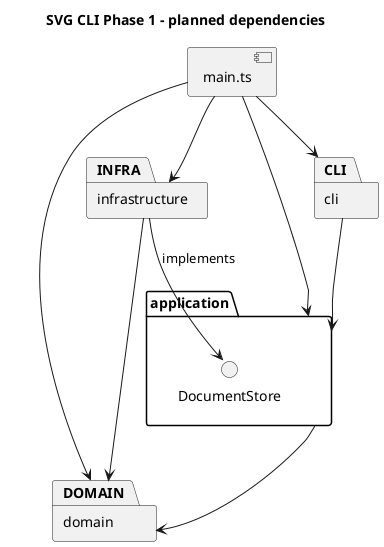
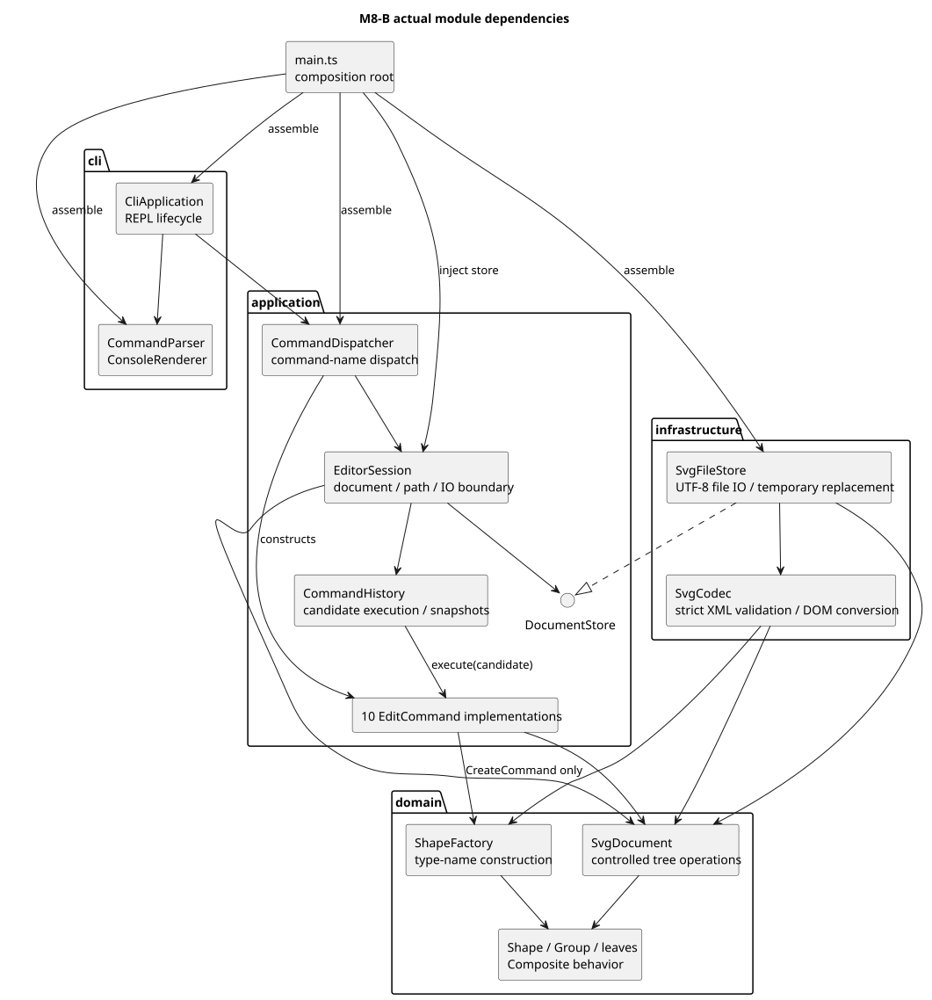
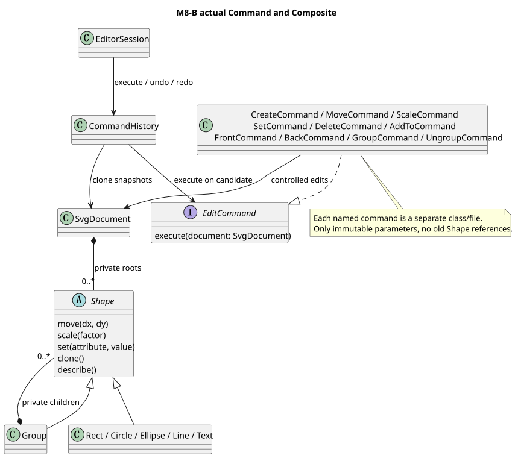

# Lab1 Phase 1：SVG 编辑器（CLI）

## 1. 目标、范围与进度

使用 TypeScript 面向对象设计实现命令行 SVG 编辑器，重点是 Command、Composite、模块依赖和真实的 AI 协作过程。

**M1～M7 已提交并推送，最新提交为 0dc8a0646ead8e34ee11a62841127757819679cf。M8-A 已完成；M8-B 已通过设计和文档审核，当前进行最终提交前核验，尚未提交。** 19 条课程命令均已实现。当前完整测试为 **246 项通过、0 失败、0 跳过**；M8-A 的 223 项及当时发现的失败反例保留为历史。尚未最终提交或创建 final 标签。

需求依据：课程 `phase_cli_1.md`，本机原件位于 `D:/learning/读研/1.1/高级软件开发/phase_cli_1.md`。本说明不替代原始要求。

| 类别 | Phase 1 范围 |
| --- | --- |
| 交互 | svg> 提示符、逐行输入、# 开头的注释行、双引号参数、成功摘要、error: 错误前缀 |
| 文档 | init、read、save、canvas；默认画布 800×600 |
| 图形 | rect、circle、ellipse、line、text、g |
| 编辑 | create（含 in）、delete、move、scale、set、group、ungroup、addto、front、back |
| 查询 | tree（含关键几何属性）、show（含父级）、help |
| 历史 | undo/redo，一条编辑一个单元，新编辑清空 redo，文档操作后的禁用规则 |
| 文件 | 保存标准 SVG；读入约定子集；缺 id 自动补齐并警告 |

图形和容器 id 在全文档内唯一且大小写敏感。失败不改变文档、路径和历史。未指定 fill/stroke 时保持缺省；scale 同时缩放位置与尺寸；根级容器禁止 ungroup。set 只允许原文规定的属性。

不实现 box、ShapeProvider 插件、动态加载、GUI 或路径寻址；create box 按未知类型报错。

交付需 Git 分步提交并推送远程仓库，最终提交在截止时间前打 final 标签。本文件包括架构、过程、一致性自查及质量保证。远程仓库为 https://github.com/kkkkkeeee/svg-editor-lab1；截止时间待用户提供。本轮 M8-B 不暂存、提交、推送或创建标签，审核后另行安排。

## 2. 环境、脚本与目录

已检查的环境：Node.js 20.9.0、npm 10.1.0、Git 2.38.1；依赖 TypeScript 5.9.3、tsx 4.23.15、@types/node 20.19.43，版本由 package-lock.json 锁定。M1 未增加依赖。

在 VS Code 打开项目根目录；Windows PowerShell 可以使用 npm.cmd 替代 npm，避免 npm.ps1 执行策略问题。

| 命令 | 用途 |
| --- | --- |
| npm run cli | 使用 tsx 启动基础 SVG CLI |
| npm run typecheck | 检查生产代码和测试代码，不生成文件 |
| npm run build | 将 src 编译到 dist，不编译测试到发布目录 |
| npm test | 使用 Node 内置 node:test 和已有 tsx 运行 TypeScript 测试 |
| npm start | 运行 dist/main.js，需要先 build |

F5 沿用已有配置，先编译再调试。打开 examples/preview.svg 可用 SVG Preview 或浏览器查看。

```text
assignment1/
├── .vscode/                 # 已有任务、调试和编辑器配置
├── src/
│   ├── main.ts              # 组装会话、分发器、解析器、显示器与 REPL
│   ├── cli/                 # CliApplication、CommandParser、ConsoleRenderer
│   ├── application/         # EditorSession、CommandDispatcher、CommandHistory、DocumentFormatter、NumericArgument、DocumentStore 接口
│   │   └── commands/        # EditCommand 接口、CreateCommand、MoveCommand、ScaleCommand、SetCommand、DeleteCommand、AddToCommand、FrontCommand、BackCommand、GroupCommand、UngroupCommand
│   ├── domain/
│   │   ├── Shape.ts
│   │   ├── ShapeFactory.ts
│   │   ├── SvgDocument.ts
│   │   └── shapes/          # Rect.ts、Circle.ts、Ellipse.ts、Line.ts、Text.ts、Group.ts
│   └── infrastructure/      # SvgCodec.ts、SvgFileStore.ts：SVG/XML 转换及文件读写
├── tests/
│   ├── EnvironmentCheck.test.ts  # 已更新为 CLI 启动/EOF 测试
│   ├── cli/Cli.test.ts
│   ├── application/         # CreateHistory、BasicEdit、DeleteCanvas、HierarchyOrder、GroupUngroup、SaveIo、ReadIo 测试（MemoryDocumentStore 为测试替代存储）
│   ├── domain/             # Shapes.test.ts、Tree.test.ts
│   └── infrastructure/     # SvgCodec.test.ts、SvgImport.test.ts、StrictXml.test.ts
├── examples/               # preview.svg、codec-preview.svg、m6b-save-preview.svg、generate-codec-preview.mjs
├── doc/README.md
├── package.json
├── package-lock.json
├── tsconfig.json
├── tsconfig.test.json
├── .npmrc
└── .gitignore
```

.gitkeep 使 Git 保留空目录，不创建空业务类；添加实际文件后可移除。node_modules、dist、.npm-cache 和日志已忽略。项目内 npm 缓存沿用此前解决写权限问题的配置。

保留原 tsconfig.json 的严格检查、NodeNext、sourceMap 和 dist/main.js 输出布局。tsconfig.test.json 继承它，将 rootDir 放宽到项目根并启用 noEmit，覆盖 src 和 tests。测试脚本显式指定入口、CLI、创建历史、基础编辑、删除画布、层级排序、分组解散、叶子及树模型、SVG 序列化、文件保存、SVG 解析、文件读取及严格 XML 回归共十四个测试文件，避免 Windows shell 通配符差异；新增测试文件时同步调整入口。

## 3. 模块划分与依赖规则

| 模块 | 职责及计划对象 | 边界 |
| --- | --- | --- |
| domain | Shape、六种图形类、SvgDocument、ShapeFactory；几何行为、属性合法性、唯一 id 与树结构约束 | 不依赖其他三层，不读取终端或文件，不打印 |
| application | 独立命令类、CommandHistory、EditorSession、CommandDispatcher；组织用例和历史规则 | 依赖 domain，通过自身定义的 DocumentStore 接口请求存储 |
| cli | CliApplication、CommandParser、ConsoleRenderer；读入、分词、显示 | 调用 application，不直接修改图形或访问文件 |
| infrastructure | SvgFileStore、SvgCodec；文件操作、XML 转换 | 依赖应用层存储接口及 domain，不管理历史 |
| main.ts | 创建并连接各层对象 | 允许依赖各层，不承载业务规则 |

以下 PlantUML 包图表示计划中的代码依赖，不是运行时调用顺序。



依赖规则与理由：

1. domain 不知道终端和磁盘，可直接测试图形规则。
2. application 不导入 infrastructure，依赖自身 DocumentStore 接口；测试可用内存替代实现模拟读写失败。
3. cli 不直接导入 domain/infrastructure，避免绕过命令和历史；显示所需的只读结果由 application 提供。
4. infrastructure 构建和转换领域对象，但不执行编辑命令或更改历史。
5. main 只组装对象；层内也避免循环依赖。后续违反规则的依赖应记录为待处理项。

按名字分派只集中于 CommandDispatcher（命令名）和 ShapeFactory（图形类型），按作业要求两处均标为**待重构点**，M1 不实现。SVG 导入复用图形工厂，不另建一套标签分派。几何依靠多态；显示和序列化通过对象提供的只读描述取得数据，不到处 switch(tag)。只读传输描述不持有可修改的业务状态，不能替代有行为的领域对象。

## 4. Command 与快照恢复方案

每种编辑由独立 Command 对象表达。例如 MoveCommand 保存目标 id、dx、dy，执行时取得当前文档并调用 document.move(id, dx, dy)，文档再多态调用目标图形的 move。M2-B 明确 find 返回独立副本，命令不能通过 find(id).move(...) 修改文档。命令负责用例，图形负责几何规则，文档维护受控编辑边界，历史管理器负责记录恢复。快照只是撤销的实现手段，不能把编辑退化成过程式大函数。

暂定一次成功编辑保存文档的前后深拷贝快照。查询不进入历史；失败编辑不产生历史、不清空 redo，也不解除 IO 禁用状态。

为避免快照恢复后对象引用失效，约定：

- EditorSession 是稳定对象，持有可替换的当前文档。
- 命令长期只保存 id、不可变参数；需要会话引用时只能保存稳定的 session，不缓存 Shape、Group、旧文档或子节点数组。M3-B 由 session 在执行时提供候选文档，CreateCommand 无需保存 session。查询取得副本，编辑通过文档受控方法执行。
- CLI 不缓存可修改的领域对象，对外提供只读结果。
- 深拷贝保留实际类和方法，不能把 JSON.parse/stringify 得到的数据袋当作领域模型。
- 记录和恢复都要复制，避免新编辑修改历史快照；父子关系、顺序、属性缺省状态都要保留。
- 若后续增加 id 索引，恢复时重建索引，不能保留旧对象引用。当前先递归查找，不引入索引维护复杂度。
- 编辑前先校验；复杂编辑中途失败则恢复编辑前快照。只在编辑成功后修改历史。

后续将用“撤销后编辑同一 id”“删除容器再撤销”“分组恢复父级与顺序”等用例验证引用问题，M1 尚未实现这些行为。

完整快照比逆操作占用更多内存，但小型课程项目中更容易正确恢复；暂不引入增量日志或复杂历史框架。

## 5. Composite 方案

Shape 提供 move、scale、set 等共同接口；Rect、Circle 等是叶子，Group 私有持有 Shape 子节点。Group 移动/缩放时调用孩子的对应方法，孩子可以继续是 Group，命令无需判断目标是叶子还是容器。

图形封装可修改字段，通过方法校验几何和属性。SvgDocument 维护唯一 id 和结构变更入口；Group 的 withChildren 产生新的容器，children 返回冻结列表中的独立图形副本，外部不能直接更改内部树。delete 通过文档统一入口移除节点及整棵子树。

统一操作不意味着所有类型接受所有属性：Group 没有 width，应该拒绝此类 set。普通 g 的样式暂拟使用 SVG 继承，不采用 box 的特殊传播规则。

## 6. 已确认决策、假设与歧义

### 已确认

- 四层架构，TypeScript 面向对象，一类一文件且文件名与类名一致。
- 独立 Command、Composite、暂定深拷贝快照，不提前生成空业务类。
- 成功 init/read/save/canvas 尺寸修改后禁止 undo/redo。清空旧历史作为内部策略，下次成功编辑开始新历史；失败不改变状态。
- canvas 无参数查询不影响历史。
- 几何行为和属性合法性在图形类内部，不开放任意修改字段。
- 不引入通用插件框架；不实现 box。
- # 只在注释行起始起作用，命令中的 #ffffff 必须保留为颜色参数。

### 待确认假设

| 问题 | 暂定方案或待明确内容 |
| --- | --- |
| 跨父容器 group | 同父级放在最早被选节点位置；跨父级新组放根级末尾，孩子按操作前文档遍历顺序排列。M5-B 已采纳为项目设计约定（非课程逐字规定），详见第 20 节 |
| 普通 g 的 set | 样式写到 g，让未显式设置属性的孩子继承，不覆盖孩子显式样式 |
| front/back | front 是视觉最上层，即同级 SVG 列表末尾；back 是开头 |
| save 路径 | M6-B 已采用：init 清除路径；成功显式 save 更新默认路径，原文仅明确 read 路径，详见第 23 节 |
| help | 建议无文档也可使用，与启动提示一致；原文“其他命令”表述较宽 |
| 数值/语法 | 建议拒绝 NaN/Infinity、允许负坐标；零尺寸、init 单参数、引号转义、空历史错误、无效果编辑是否入栈需提前定表 |
| 自动 id | 先收集全部显式 id，再分配未占用的标签名+序号；显式重复 id 拒绝读入 |

### SVG 导入范围

最低目标是六种元素、嵌套 g、课程列出的几何/样式属性、文本及补 id，使自身输出和原文 other.svg 可读回。

完整任意 SVG 兼容性不是当前承诺。背景例子含 transform、font-size、text-anchor，但命令白名单和导入细则未完整定义处理方式。M7 已明确拒绝这些属性、非默认 viewBox、单位、style/CSS、path/defs/use 及未知属性，保持原文档；兼容表详见第 25 节。data-kind="box" 遵循原文降级为普通 g 的语义，不创建 box 类型。

M1 规划时不实现解析、不选择或安装 XML 库；M6-A 新增的 XML 库当时仅用于测试（见第 22 节），M7 将同版本转为运行依赖。现已先构建并验证临时文档，再替换当前文档；解析失败不污染原状态。文本/属性、子节点顺序及属性缺省均纳入往返测试。

## 7. 变化点与取舍

| 变化点 | 本阶段准备 | 暂不做的事及理由 |
| --- | --- | --- |
| 新命令 | 独立命令类、集中分发 | 不做通用命令插件 |
| 新图形 | Shape 多态、集中工厂 | 不做 ShapeProvider/box，避免提前设计不确定接口 |
| 新交互方式 | CLI 与应用分离 | 不实现 GUI/网络服务 |
| 存储变化 | 小型 DocumentStore 接口隔离 IO | 不构建通用存储平台 |
| 大文档 | 集中管理历史，便于以后替换快照策略 | 暂不做增量快照和复杂索引，先保证正确性 |
| 导入范围变化 | XML 封装在 infrastructure | 不承诺完整 SVG 规范兼容 |

## 8. 八个里程碑

| 阶段 | 范围 | 验证与提交节点 |
| --- | --- | --- |
| M1 工程基线 | 目录、脚本、最小测试、架构文档 | 四条命令验证，用户审核后首次提交 |
| M2 领域模型 | 六种图形、几何/属性、文档树、唯一 id | 对象级测试含非法输入与嵌套行为，通过后提交 |
| M3 最小交互 | REPL、分词、init/create/tree/show/help、Command 入口及创建历史 | 引号、注释、创建及撤销重做闭环，通过后提交 |
| M4 编辑与历史 | move/scale/set/delete/canvas、完整历史规则 | 执行/撤销/重做、失败原子性、快照独立性及引用恢复，通过后提交 |
| M5 层级与顺序 | group/ungroup/addto/front/back/in | 循环防护、根级限制、父级和顺序恢复，通过后提交 |
| M6 保存 | XML 序列化、路径、文件写入、IO 历史限制 | 转义、浏览器预览、写入失败，通过后提交 |
| M7 读入 | 约定子集、补 id、验证后替换 | other.svg、读写往返、坏文件/重复 id 不污染状态，通过后提交 |
| M8 综合交付 | 示例回放、边界测试、依赖自查、文档 | 全命令覆盖及干净安装构建，最终修正提交后安排推送和 final 标签 |

每阶段先解释设计，再实现、验证和记录，审核后推进；可有多个小提交，不能将全部实现压成一次提交。

## 9. AI 协作过程

- 2026-10-26 环境准备：读取原文，复用已有工具，安装项目 TypeScript/tsx/Node 类型及 SVG Preview。npm 原缓存目录不可写，改用项目缓存。
- 架构讨论：AI 提出四层及八阶段方案，划分 Phase 1 与插件阶段，识别 group、SVG 导入及历史规则歧义。用户审核后保留四层和八阶段。
- M1 用户修订：快照不能替代 Command，需避免恢复后的引用问题；跨父级 group 仅为假设；canvas 查询不影响历史；禁止本轮提交和提前实现业务。
- M1 工程调整：保留生产配置与入口，用独立测试配置检查测试文件；采用 Node 内置测试验证真实入口和中文输出；四层只建立目录占位。

后续记录真实反例、修正和验证，不补造未发生的讨论或结果。

## 10. 一致性自查与质量保证

当前四层目录与计划一致。图形、文档与工厂仅依赖领域层，没有反向依赖 CLI、应用或基础设施；应用层管理会话、编辑命令、历史和查询，CLI 通过应用层访问业务。M3-A 已移除临时 EnvironmentCheck 类，入口测试改为验证真实 CLI 启动与 EOF；M1 原测试结果保留为历史记录。

当前入口测试启动真实 src/main.ts，检查欢迎语、提示符和空输入 EOF 正常退出。M1 阶段的环境检查与中文输出结果保留在下方历史记录中；领域、应用及交互行为由各阶段测试分别验证。

### M1 实际验证记录（2026-10-26）

在项目根目录使用 Windows PowerShell 执行以下命令，均成功退出（退出码 0）。npm.cmd 与本节上方 npm 命令对应同一组脚本。

| 实际命令 | 实际结果 |
| --- | --- |
| `npm.cmd run cli` | 输出 Environment OK、Node.js v20.9.0、UTF-8 中文提示及“实验命令尚未实现” |
| `npm.cmd run typecheck` | 生产配置与测试配置均通过，无类型错误 |
| `npm.cmd run build` | tsc 成功编译 |
| `npm.cmd test` | TAP 报告 tests 1、pass 1、fail 0、skipped 0 |

本次未遇到编译或测试错误。Git 状态为 master 尚无提交，项目文件均未跟踪；新增四层占位文件与测试配置均出现在状态清单中。未执行暂存、commit、push 或 tag，未新增依赖。

后续需对象测试、命令历史测试、文件往返、CLI 脚本回放及浏览器预览；抽样审查 import 并记录依赖违规项。PlantUML 当前提供文本源码，尚未进行渲染验证。M1 测试通过只说明工程基线可用，不表示业务功能完成。

## 11. M2-A：叶子图形实现（2026-10-27）

### 已实现与设计取舍

新增 domain/Shape.ts 及 domain/shapes 下 Rect、Circle、Ellipse、Line、Text 五个类，一类一文件。Shape 定义抽象 move、scale、describe，提供公共 set 样式校验，通过受保护的 setGeometry 多态处理各类专属属性。属性白名单检查不是按图形标签分派；当前没有 switch(tag)、图形工厂或业务自由函数。

- 状态使用 JavaScript # 私有字段，id 只有 getter。id 非空且不含空白，保留大小写和中文；文档内唯一性留给 M2-B，不使用全局注册表。
- describe 返回冻结的独立描述及冻结的 attributes。值均为基本类型，不泄漏内部引用；这是只读展示数据，不是可写业务模型，也不是未来恢复快照。
- text 内容在描述的 text 字段，和 SVG attributes 分离。空文本合法；移动缩放不改变内容。
- 领域层几何输入必须是 number，set 的数字属性也不接受 "12" 字符串；后续输入层负责转换，避免空字符串意外转为零。所有数值及运算结果必须有限。
- 本轮采用可审核的边界策略：负坐标合法；宽高、半径和 stroke-width 可为零但不能为负；scale 系数为有限正数。这细化了此前未定的零尺寸策略，不声称课程原文规定了所有边界。
- scale 乘到全部几何位置和尺寸，stroke-width 属样式暂不随之缩放。Text 只有 x/y 几何字段，不额外加入 font-size。
- fill/stroke 不补默认值；只检查非空字符串，不实现 CSS 颜色语法解析器。传入样式被复制，不保留调用者的可修改引用。
- move/scale 先生成并检查全部候选几何值，再一次替换私有状态；set 先校验再赋值。包括数值溢出在内的失败不会留下部分变更，无需提前引入 Undo/Redo。
- 领域层抛出 Error，不打印、不添加 CLI 的 error: 前缀，未来由 CLI 统一处理展示。

公共校验在基类复用，具体几何公式和白名单保留在各子类内。少量重复让初学者可以直接读懂每种图形的行为，本轮不为减少行数引入通用几何引擎或额外继承层。

### 测试与验证

新增 tests/domain/Shapes.test.ts：五种图形分别覆盖创建、缺省样式、移动、缩放、每个几何属性和公共样式修改、非法输入、构造校验、零尺寸、运算溢出、只读描述及 id。额外验证文本内容和跨类型属性拒绝。共享测试用例以 Shape 类型调用对象，验证相同接口下的不同几何行为。

实际执行结果：npm.cmd run typecheck、npm.cmd run build、npm.cmd test、npm.cmd run cli 均以退出码 0 完成；测试共 38 项通过、0 项失败、0 项跳过（37 项领域测试加 1 项原有入口测试）。入口保持原来的环境提示。未新增依赖，未更改入口或编译配置。

### 过程与一致性记录

用户限定本轮为 M2-A，不实现 Group、SvgDocument、ShapeFactory 或应用层。AI 在实现前说明了数值边界和原子修改策略；测试增加“前一个坐标可成功、后一个坐标溢出”的反例，验证不会先改一半再报错。当前领域类仅相互依赖，不导入其他三层。

移除已不需要的 domain/.gitkeep，另外三层占位仍保留。M1 已于此前完成首次提交 82eca1b；本轮仅修改工作区，等待用户审核，不提交、不推送、不打标签。M2-B 及后续里程碑仍未开始。

## 12. M2-B：容器、文档、工厂与深拷贝（2026-10-27）

### M2-A 自查与最小扩展

重新审阅 Shape 和五个叶子类：move/scale/set 均在校验成功后才赋值，失败不改状态；describe 返回冻结独立描述，不泄漏内部对象；各类单独文件且只依赖领域层，没有图形类型分派。没有发现需要修复的叶子行为错误。

现有接口不足以表达深拷贝和树描述，因此为 Shape 增加抽象 clone、容器能力标识 isContainer、children 查询及产生新结构的 withChildren；ShapeDescription 增加可选 children。叶子 children 为空，withChildren 明确拒绝。五个叶子的 clone 通过各自构造器保留类行为、id、几何、文本与样式，不改变原有几何公式。

### 已实现对象与接口

| 对象 | 主要接口与职责 |
| --- | --- |
| Group | 嵌套容器，继承 Shape；move/scale 多态递归；set 只设置组本身公共样式；withChildren 返回新组；私有保存子节点副本 |
| SvgDocument | 默认 800×600；resize、add、delete、find、getParentId、reparent、move、scale、set、describe、clone；管理尺寸、全文档唯一 id 和顺序 |
| ShapeFactory | create(type, id, params)，六种类型集中分派；检查参数数量，数值、id、文本和样式合法性仍交给图形类 |

工厂接受已经转换为 number 的几何参数，text 内容仍为 string；可选 fill/stroke 按原文位置传入。工厂中的类型断言不做运行时转换，实际值仍由图形构造器验证。未知类型（包括 box）抛出原文规定的 unknown shape type 错误。这里只创建对象，不查文档重复 id，也不解析 CLI 文本或 in 子句。

### 所有权与结构原子性

本阶段细化了 M1 的封装策略：**文档独占内部树，输入复制、查询返回副本，写操作按 id 进行。**

- Group 构造器复制输入子节点；同一外部对象放入不同容器会成为独立副本，不会形成共享父子引用。同一树内相同 id（包括根与后代）仍会被拒绝。
- Group.children 和 SvgDocument.children 返回冻结数组，其中对象是独立克隆。调用者可编辑副本，但不会改变源树。describe 返回递归冻结的只读数据。
- Group.withChildren 是结构替换构造方法，不修改原组。没有公共原地 addChild/removeChild，也没有可随意赋值的父指针，外部不能绕过文档去挂接节点。
- SvgDocument.find 返回独立 Shape 副本，找不到返回 undefined；编辑使用 document.move/scale/set，不使用 find 的结果写回。getParentId 对顶层返回 null，对缺失 id 抛错，便于后续命令检查顶层 ungroup 限制。
- add/delete/reparent 先生成候选结构，检查全部 id，再复制候选树并一次替换根集合。删除返回独立子树，后续可重新添加。
- reparent 先检查目标存在且为容器，拒绝自身与后代作为目标。新位置 index 是“源节点移除后”的目标列表索引，允许 0 到列表长度；省略为末尾。该方法也能调整同级顺序，但不是 front/back/group/ungroup CLI 命令。
- Group move/scale 先克隆孩子，逐一执行；若深层节点溢出则丢弃候选，原组和之前兄弟都不变。文档的几何编辑也先在目标副本上完成，最后统一替换。
- 组样式写在 g 自己上，保留孩子的缺省属性与显式颜色。实际 SVG 继承显示留给以后序列化和浏览器，不提前展开样式。

文档画布尺寸暂采用有限正数（可为浮点数），与叶子宽高可为零区分。resize 先同时验证两个尺寸再赋值。此为本阶段记录的边界策略。

### 深拷贝与后续快照

clone 返回同一实际类的新实例。Group 递归复制子树，SvgDocument 复制尺寸、根顺序及全部后代，不共享可变状态；id、文本和缺省样式完整保留，不通过 JSON 恢复类型。

不保证编辑前后内部对象身份稳定；该身份本来就不暴露给外部。未来 Command 保留 id 和稳定 session，从 session 取当前文档调用受控方法。当前没有 Command、CommandHistory 或 Undo/Redo；clone 只是后续快照所需的领域能力。

### 取舍、风险及架构修订

四层依赖方向、Command 与 Composite 的分工不变，无须重划 M1 模块。需要细化的是 M1 中“命令查找图形后操作”的表述，已改为“命令通过当前文档按 id 操作”，明确 find 是查询副本。

所有结构更改都能在失败前保留原树，代价是重复复制与递归遍历。当前优先保证小型课程文档的正确性，不保证大文档性能或极深嵌套的调用栈安全。今后若实际规模需要，可优化内部遍历与复制，但仍必须保留所有权和原子性契约。clone 的正确性以本阶段六种内置类型为范围，不提供任意第三方子类或插件保证。

ShapeFactory 是当前唯一按图形类型名分派的位置，已按课程要求标记待重构；其他层只使用多态或 isContainer 能力判断，没有分散的 switch(tag)。新增各类各自独立文件；接口类型与相关类共文件，不增加空类或通用框架。

### 协作与实际验证

实现前指出两个风险：简单循环调用孩子会在后面的孩子失败时留下部分更新；若外部可以直接修改文档内的 Group，则可能绕过全文档 id 检查。选用副本所有权与候选树提交解决，并将这个与 M1 相比更具体的接口约束记入本节。

新增 tests/domain/Tree.test.ts，共 24 项测试，包含嵌套几何、末尾后代失败原子性、普通组样式、自包含/循环拒绝、重复 id（含子树冲突）、非法目标/索引、顺序、父级查询、删除、输入输出引用隔离、六类双向克隆独立性、文档克隆及工厂参数校验。

实际执行：npm.cmd run typecheck、npm.cmd run build、npm.cmd test 均退出 0；总计 62 项测试通过、0 失败、0 跳过，其中原有 38 项继续通过。git diff --check 通过（仅有 Git 的 LF/CRLF 换行提示，不是差异检查错误）。没有编译或测试失败；未新增依赖，未改 M1 程序入口。

截至 M2-B 开发轮结束，M2-A 文件仍未提交，git status 同时包含两部分工作区内容；当轮未暂存、commit、push 或打标签。随后用户批准最终验收与本地提交，见下一节。未提前实现 CLI、命令历史、SVG 文件读写或插件。

## 13. M2 最终验收（2026-10-27）

用户审核 M2-A/M2-B 后授权一次本地提交。重新检查全部领域类和测试，未发现需最小修复的实际错误、意外修改或需要重构的问题，因此保留已审核的业务实现，没有增加未来阶段的接口。

- Group 的嵌套 move/scale 在候选子树上执行，失败不会替换原孩子集合。
- add/delete/reparent 通过候选树校验和复制维护全文档 id 唯一性与顺序。
- find 对顶层和深层结果都再次 clone，外部编辑查询结果不会修改文档。
- 六种 clone 均保留实际类、id、属性、样式缺省、文本及嵌套顺序。
- add 的插入位置、reparent 的目标位置、getParentId 及有序 children 查询，足以为后续 group/ungroup/front/back 提供基础；clone 可保存原父子关系和顺序。多次结构调用本身不构成一个事务，未来复合命令应在文档副本上完成全部步骤后发布，或按已定快照策略恢复失败状态；本轮没有实现这些命令或历史管理。
- 一类一文件；类型名分派仅位于 ShapeFactory；领域 import 没有指向其他三层。此前记录的复制开销、递归深度及仅支持内置类型的风险仍适用。

本轮重新执行的实际结果：

| 命令 | 结果 |
| --- | --- |
| npm.cmd run typecheck | 退出码 0，源码及测试类型检查通过 |
| npm.cmd run build | 退出码 0，编译成功 |
| npm.cmd test | 退出码 0，62 项通过、0 失败、0 跳过 |
| git diff --check | 退出码 0，无空白错误 |

提交范围为领域源码、两份领域测试、测试脚本调整、领域占位文件移除及本文档。检查未发现密码、Token、私钥或证书；node_modules、dist、.npm-cache 和日志仍由 .gitignore 排除。提交信息为 feat: implement SVG domain model and composite shapes，仅本地提交，不推送、不创建 final 标签、不开始 M3。实际提交哈希以 Git 日志为准，避免在提交文件中预写尚未生成的哈希。

## 14. M3-A：基础 CLI 交互（2026-10-27）

### 实现范围与职责

- CliApplication 管理 readline 生命周期、逐行事件、单条错误捕获、提示符和退出清理。
- CommandParser 解析空白分隔、双引号、空字符串及转义，输出应用层定义的不可变 CommandRequest；不访问文档。
- ConsoleRenderer 负责欢迎语、提示符文本、终端写入及单行 error: 格式。
- EditorSession 私有持有当前 SvgDocument。init 先构造验证新文档再替换；describe 只返回冻结描述，旧描述不受重复 init 影响。
- CommandDispatcher 集中维护命令目录、通用参数个数、是否需要文档和实现状态，仅执行 help/init。未实现命令明确报错；没有提前生成编辑 Command 类。
- main.ts 只创建并连接上述对象，移除临时 EnvironmentCheck 类。原入口测试文件保留名称，改为真实 CLI 的启动/EOF 验证。

依赖仍为 cli → application → domain，CLI 不导入领域类，领域代码及既有领域测试无修改。命令名分派仍只在 CommandDispatcher，图形名分派仍只在 ShapeFactory，均保留为后续重构点。当前轻量分发结果是显示文本，未引入通用消息框架。解析器负责词法及引号语法，命令参数数量和 init 数字转换集中在分发入口，避免再建第二套命令名分派。

### 输入约定与错误优先级

空行和去除前导空白后以 # 开头的行被跳过；其他位置的 # 保留，包含 #ffffff 颜色。双引号参数保留内部空格、中文及空字符串。引号内支持转义双引号和反斜杠，其他反斜杠保留；引号参数必须由空白分隔，不支持与未引用片段直接拼接。未闭合引号明确报错。

init 不带参数使用 800×600；一个参数视为宽度，高度默认 600；两个参数设置宽高。几何文本只接受十进制数（含小数和科学记数法），拒绝空串和十六进制；尺寸正数/有限性沿用 SvgDocument 校验。超过两个参数报 usage 错误，失败不替换已有文档。单参数行为是本阶段对原先歧义的明确实现约定。

help 不要求文档，列出全部 19 个命令及语法，help/init 标为已实现，其余 17 个标为暂未实现，并补充六种 create 类型参数说明。

错误检查顺序为：词法错误 → 未知命令 → 需要文档但尚未初始化 → 基本参数个数错误 → 已实现功能执行/未实现提示。read 是建立文档的命令，不要求当前已有文档，但本阶段只报尚未实现。未实现命令仅检查基本参数数量，不假装完整解析其类型参数或执行成功。尚无 Undo/Redo，init 后的历史禁用机制留到后续阶段。

### REPL 与退出

使用 readline 的 line 事件同步消费本阶段命令，不使用反复 question 等待下一行的方式，避免一次性管道输入时漏掉行。交互 TTY 启用终端编辑；管道使用非终端模式，仍输出欢迎语和 svg> 提示符。空行/注释后继续显示提示符。单条失败输出 error: 后继续处理下一行。

EOF 由 readline close 结束；Ctrl+C 关闭 reader，移除进程 SIGINT 监听器、暂停输入并释放拥有的 TTY 输入句柄。该 REPL 是一次性的输入消费者；不会关闭调用方注入的普通非 TTY 流。错误统一写到当前输出流，便于本阶段会话回放。

### 验证与真实交互记录

最终重新执行 npm.cmd run typecheck、npm.cmd run build、npm.cmd test，均退出 0。测试总计 73 项通过、0 失败、0 跳过：61 项 M2 领域测试保持原样通过，1 项原入口测试更新为真实 CLI EOF，新增 11 项解析/应用/REPL 测试。git diff --check 通过。

覆盖默认/指定/单参数/重复 init、非法尺寸保持原文档、双引号和空参数、注释和颜色、未闭合引号、错误后继续、全部帮助状态、未知与未实现区分、空输入 EOF、多行管道/CRLF/末行无换行、模拟终端 Ctrl+C 及信号监听清理。

真实 Windows PTY 中运行编译后的 node dist/main.js，确认欢迎语、提示符、无文档错误、默认及指定 init、未知命令、带空格文字及颜色的未实现提示、完整 help、未闭合引号和参数数量错误后的恢复。实际输出节选：

```text
svg-editor 0.1 — type 'help' for commands
svg> tree
error: no document. use 'init' or 'read' first
svg> init
canvas 800x600 created
svg> init 400 200
canvas 400x200 created
svg> wat
error: unknown command: wat
svg> create text t1 20 40 "Hello World"
error: command not implemented yet: create
svg> init 1 2 3
error: invalid arguments; usage: init [w] [h]
svg> init 320
canvas 320x600 created
```

验证中沙箱 PTY 在 Ctrl+C/终端 EOF 后未返回结束状态；不能仅凭这种现象断言应用没有退出。检查退出路径后补充显式暂停/释放 TTY 输入，并经授权在沙箱外重复真实终端测试：启动、init、Ctrl+C 后 PowerShell 明确打印 CLI_EXIT_CODE=0。模拟流测试不能替代真实终端验证；已将这一差异如实记录。管道 EOF 的实际子进程退出码由自动测试确认。

M3-A 没有新增依赖或修改领域模型；未实现 create/tree/show 业务、编辑、历史、文件读写或插件。本轮仅保留工作区改动供审核，不提交、不推送、不创建标签，不开始 M3-B。

## 15. M3-B：创建、查询与 Command 最小闭环（2026-10-28）

### 实现与架构

M3-A 经用户审核后进入本阶段。上方各阶段记录描述当时的实现和测试，不代表当前功能仍然缺失。当前 help 将 help/init/create/tree/show/undo/redo 标为已实现，其余 12 个命令继续明确提示尚未实现。

新增 EditCommand 接口、CreateCommand、CommandHistory 和 DocumentFormatter。CreateCommand 保存复制后的只读参数、类型、id 和目标容器 id，通过 ShapeFactory 创建图形并调用 SvgDocument.add；不缓存图形、旧文档或可变会话内容。EditorSession.execute 是统一编辑入口，CommandDispatcher 只解析尾部归属并构造命令，不承载创建业务。命令执行时接收候选文档，因此不需要额外保存 session 引用，也不会因撤销替换文档而引用失效。

CommandHistory 通过 SvgDocument.clone 保存前后快照。执行过程先复制当前文档，在候选副本上执行命令，再复制结果，全部成功后才追加历史并清空 redo，最后由 session 发布文档。失败即丢弃候选副本；即使命令先改候选树后抛错，也不污染当前文档或历史。每次成功 create 是一个撤销单元。undo/redo 恢复快照副本，保留实际类行为、顺序和嵌套关系；redo 不重新执行创建。成功 init 清空历史并禁用 undo/redo，报原文规定的 undo not allowed after io command；只有下一次成功编辑解除禁用，失败 init 保留原文档和历史。tree/show/help 不进入历史。

DocumentFormatter 使用只读描述递归输出层级和属性，不按类型 switch。tree 支持全文档或子树，保留真实子节点顺序；show 展示几何、显式样式、文本及父容器，顶层标为 parent=svg。几何使用领域属性全名 width/height，没有额外缩写映射。

领域模型无需重设；唯一领域改动是 ShapeFactory 增加 createFromTokens，使数字字符串转换与已有类型分派共用同一个创建路径。几何合法性仍由具体图形校验，旧 create 接口仍保留严格数值调用。CLI 不导入领域对象，依赖仍为 cli → application → domain。无新增依赖或插件框架。

### 解析约定与错误

支持 rect/circle/ellipse/line/text/g 和尾部 in 容器，包括嵌套 g；省略 fill/stroke 时保持缺省。解析器额外保存引号标记，以区别文本参数 "in" 与未加引号的尾部 in 关键字。中文、空格、空文本、颜色 #ffffff 均保留。创建参数中的数字只接受十进制形式（含科学记数法），有限性与几何范围继续交给领域类校验。

重复 id、非法尺寸、未知类型（包括 box）、目标不存在及目标非容器均明确报错。原文的 unknown shape type、no such container、not a container 语义保留。历史已经启用但栈为空时分别报 nothing to undo / nothing to redo；这是原文未详细规定的提示约定。

### 实际测试与协作记录

新增 tests/application/CreateHistory.test.ts 共 22 项应用及真实 CLI 子进程测试；原 M3-A 测试中“create 尚未实现”的预期更新为创建成功，帮助状态同步更新，原领域测试保持不变。完整测试为 95 项（73 项既有测试加 22 项新增），全部通过、0 失败、0 跳过。

覆盖六类型、in 归属与顺序、重复 id、非法参数/容器/类型、tree/show 输出、多步撤销重做、新编辑清空 redo、失败保留 redo、init 禁用及成功编辑解禁、失败 init、快照具体类型与隔离、候选文档修改后抛错的原子性、真实多行 REPL/EOF。额外检查命令参数副本，以及外部修改历史返回值不会污染快照。

npm.cmd run typecheck、npm.cmd run build、npm.cmd test 均退出 0。git diff --check 曾发现 ShapeFactory 文件末尾空行，已清理；最终检查退出码 0，无空白错误（仅有 LF/CRLF 换行提示）。通过编译后的 node dist/main.js 实际运行多行管道会话，退出码 0，包含 init、创建容器/矩形/文本、tree/show、undo/redo。管道不会回显输入，以下按输入和实际输出整理节选：

```text
svg> init 800 600
canvas 800x600 created
svg> create g scene
g#scene created
svg> create rect r1 10 20 100 50 red in scene
rect#r1 created in g#scene
svg> create text title 20 40 "Hello World" in scene
text#title created in g#scene
svg> tree
svg (800x600)
└── g#scene
    ├── rect#r1  x=10 y=20 width=100 height=50 fill=red
    └── text#title  x=20 y=40 text="Hello World"
svg> show r1
rect#r1  parent=g#scene
  x=10 y=20 width=100 height=50 fill=red
svg> undo
undone: text#title created in g#scene
svg> redo
redone: text#title created in g#scene
```

### 取舍、风险与阶段边界

前后完整快照和额外隔离副本使失败原子性更容易理解和验证，但每次编辑需要复制整份文档，历史随编辑次数增长；本阶段没有容量上限。递归查询、输出和克隆仍不保证极深树的栈安全。当前适用于小型课程文档，后续若需要优化应保留隔离契约。四层方案不变，只将 Command 的文档获取方式细化为执行时注入候选文档。

M1/M2 已本地提交；M3-A 和 M3-B 当前均保留在工作区等待审核。本轮不暂存、不提交、不推送、不创建标签。没有实现 M4 编辑命令、结构命令、文件读写或插件；这些命令仍提示尚未实现。

## 16. M4-A：基础编辑命令（2026-10-28）

### 实现与设计取舍

用户确认 M1～M3 已提交并推送，本轮仅完成基础编辑，不提交或推送。新增 MoveCommand、ScaleCommand、SetCommand，每类一文件、实现既有 EditCommand，保存 id 和不可变参数，不缓存 Shape 或文档。CommandDispatcher 启用三条命令，统一调用 EditorSession.execute；CreateCommand、EditorSession、CommandHistory 及领域层无需修改。

MoveCommand 调用 SvgDocument.move，ScaleCommand 调用 SvgDocument.scale，叶子和 Group 的差异由原有多态处理；移动允许负数与小数，缩放因子必须有限且为正。所有位置及尺寸随缩放改变，stroke-width 是样式，沿用领域行为不参与几何缩放。输出使用通用 moved by / scaled by 摘要，避免为不同图形构造新的类型分派。

SetCommand 先查询目标的独立副本，依据只读描述中属性的数值类型识别几何输入；stroke-width 可能缺省，因此显式作为数值属性处理。字符串 fill/stroke/text 不转换、不裁剪内容。白名单及范围仍由领域图形的 set 校验：Group 只接受公共样式，其他类型只接受自己的几何属性；id、transform、font-size、label 等拒绝。没有添加按图形类型 switch 或重复维护类型到白名单的表。该方案依赖现有契约：全部几何属性始终出现在 describe 中且值为 number；未来若引入可缺省数值几何属性，需重新明确该输入契约。

NumericArgument 是小型应用层数值文本转换类，供本次三个命令使用：接受十进制、小数和科学记数法，拒绝空串、十六进制、单位、NaN、Infinity、溢出的数值文本。原有 init/create 转换保持不动，避免扩大本轮范围。数值范围与计算结果合法性仍由领域层验证。

成功编辑沿用完整前后快照，每条命令一个撤销单元。候选文档上的几何运算或 set 失败时不发布状态，也不更新历史或清空 redo。成功的新编辑清空 redo；恢复后按 id 取得当前对象，因此重用命令不会指向旧图形。Group 样式只写在组自身，孩子显式样式不被覆盖，缺省样式也不主动展开。

### 验证与真实问题

新增 tests/application/BasicEdit.test.ts，18 项测试，总计 113 项（原 95 项保留）。覆盖五种叶子的移动、缩放和全部几何白名单，公共样式，中文/空格/空文本/数字文本，嵌套组及顺序，样式继承表示，数值非法输入，未知属性/id，参数数量，多步撤销重做、新编辑清空 redo、失败保留 redo、命令复用和真实 REPL 多行子进程。

溢出反例特意将正常孩子排在前、极大坐标后代放在后：move 或 scale 后者溢出时，整份文档必须与操作前相同，并且原 redo 仍能恢复。这也验证了已有 Composite 和历史隔离协同工作。

原 CLI 测试中“move 尚未实现”的预期已随阶段推进改为明确的目标不存在错误或成功摘要；help 状态改为已实现，同时保留 save/read/delete 等未实现命令的拒绝断言。没有删除旧测试或放宽错误匹配来掩盖失败，领域测试未修改。

首次测试执行 113 项通过，但类型检查发现新增测试使用 assert.throws(fn, undefined, message) 不符合当前 @types/node 的重载；改为明确要求 Error 实例后重新运行。最终 npm.cmd run typecheck、npm.cmd run build、npm.cmd test 均退出 0；113 项通过、0 失败、0 跳过。git diff --check 最终检查无空白错误，仅有 Git 的 LF/CRLF 换行提示。

另外实际运行编译后的 node dist/main.js，通过管道输入多行命令，正常 EOF 退出码为 0。以下将输入与实际输出整理在一起：

```text
svg> init
canvas 800x600 created
svg> create g scene
g#scene created
svg> create rect r 10 20 100 50 red in scene
rect#r created in g#scene
svg> move scene -5 .5
g#scene moved by (-5,0.5)
svg> scale scene 2
g#scene scaled by 2
svg> set r fill #ffffff
rect#r updated: fill="#ffffff"
svg> undo
undone: rect#r updated: fill="#ffffff"
svg> redo
redone: rect#r updated: fill="#ffffff"
svg> scale scene 0
error: scale factor must be positive
svg> show r
rect#r  parent=g#scene
  x=10 y=41 width=200 height=100 fill=#ffffff
```

### 一致性与剩余风险

四层依赖方向不变，没有新增分发中心。CLI 不导入领域模型；三个命令调用领域受控接口，未改变 CreateCommand 或已有历史行为。无需修订总体架构，只补充数值文本转换与 set 输入类型识别的具体约定。无新依赖。

完整快照内存开销、历史无容量上限、极深树递归栈风险仍在；JavaScript 浮点数也有精度限制，目前验证有限性，不提供高精度十进制运算。零位移或设置同值仍按一次成功编辑记录历史。删除、canvas、结构调整、SVG 读写和插件均未实现，本轮改动保留工作区等待审核。

## 17. M4-B：删除与画布管理（2026-10-28）

### 实现与历史边界

M4-A 经用户审核后继续本阶段。新增 DeleteCommand，实现原 EditCommand，仅保存 id，通过 SvgDocument.delete 一次删除目标，返回实际类型的 deleted 摘要；不使用工厂或图形类型分派。容器连同全部后代删除，整个操作只调用一次 EditorSession.execute，所以只有一个撤销单元。恢复依赖已有完整文档快照，保留父容器、兄弟顺序、样式缺省、文本和具体类行为。

EditorSession 最小新增 resizeCanvas：克隆当前文档，在候选文档上调用 resize 并生成返回描述，成功后发布文档并调用原 CommandHistory.resetAfterIo。失败时当前文档及历史均不变。没有新增 CanvasCommand，没有修改领域模型、历史管理器或 init。复制整份文档有开销，但沿用既有候选文档提交方式，避免失败后部分发布状态。

CommandDispatcher 启用 delete 与 canvas，帮助现有 12 项已实现、7 项未实现。canvas 无参数通过只读 describe 查询宽高，不进入历史、不改变禁用状态。两个参数复用 init 的数值文本转换，尺寸范围仍由 SvgDocument 校验；成功输出 canvas WxH resized，查询输出 canvas WxH。只传一个参数拒绝，usage 为 canvas [w h]，两个可选尺寸视为一组；init 单参数仍使用默认高度 600。原文没有定义 canvas 单参数修改规则，因此按用户明确要求拒绝，避免意外重置高度。

成功 resize（即使尺寸和原来相同）清空 undo/redo 并禁用历史；之后失败编辑不能解除禁用。下一次成功 create/move/scale/set/delete 开启新的历史，撤销到该编辑之前仍是调整后的画布，不可跨越尺寸修改边界。非法尺寸、错误参数数量、失败删除不会清空旧 redo。无文档时遵循原文 no document 错误。

### 真实过程及验证

现有 SvgDocument.delete、resize 与快照机制已经满足本阶段语义，没有发现需要重构的架构冲突。旧 help 状态随实现更新，M4-A 实际会话测试中的 delete 未实现断言改为准确的 rect#r deleted，保留其他全部断言；新会话仍检查 save 尚未实现。没有删掉旧测试或放宽断言。

新增 tests/application/DeleteCanvas.test.ts，11 项测试覆盖叶子与多层子树删除、一次撤销恢复父级和顺序、反复 undo/redo、具体类行为、删除后复用 id、独立命令复用、五类编辑混合历史、查询不影响历史、非法尺寸/参数、成功修改清空 redo、失败编辑维持禁用、下一次编辑解禁、原图形树不变、同尺寸边界、init 单参数及真实多行 REPL。测试通过完整描述相等来检查状态，同时以 redo 实际执行来证明失败没有破坏历史。

本轮首次运行 npm.cmd run typecheck、npm.cmd run build、npm.cmd test 均成功，退出码 0；共 124 项通过（原 113 项加新增 11 项）、0 失败、0 跳过。git diff --check 无空白错误，仅有 LF/CRLF 提示。没有新增依赖。

另在编译后的 node dist/main.js 执行真实多行管道会话，EOF 正常退出，退出码 0。按输入/输出整理节选（期间也执行 redo、undo 验证重复恢复）：

```text
svg> init
canvas 800x600 created
svg> canvas
canvas 800x600
svg> create g scene
g#scene created
svg> create rect r 1 2 3 4 in scene
rect#r created in g#scene
svg> delete scene
g#scene deleted
svg> undo
undone: g#scene deleted
svg> show r
rect#r  parent=g#scene
  x=1 y=2 width=3 height=4
svg> canvas 400 300
canvas 400x300 resized
svg> undo
error: undo not allowed after io command
svg> delete missing
error: no such shape: missing
svg> redo
error: undo not allowed after io command
svg> canvas 100
error: invalid arguments; usage: canvas [w h]
svg> canvas
canvas 400x300
svg> delete r
rect#r deleted
svg> undo
undone: rect#r deleted
```

### 架构、自查与状态

四层架构不变；应用层编排删除和尺寸修改，领域层仍负责树结构及尺寸合法性，CLI 不直接操作领域字段。CommandHistory、CreateCommand 及领域源码保持不变。此前完整快照的内存、递归深度与浮点精度风险仍然存在，本轮没有增加通用事务或插件设施。

M4-A 与 M4-B 均保留在工作区，未暂存、提交、推送或创建标签。group/ungroup/addto/front/back/read/save 继续明确提示未实现；不开始后续阶段。

## 18. M4 最终验收（2026-10-28）

用户审核 M4-A/M4-B 后授权第四次提交及推送。最终检查确认本轮全部变更属于 M4：四个独立编辑命令、数值解析、分发及会话尺寸入口、两份新增测试、旧测试的阶段预期调整、测试脚本和文档。没有发现意外文件或敏感凭据；构建产物、依赖、缓存、日志由 .gitignore 排除。本轮不增加新功能，无需生产代码修复或架构重构，上方开发历史保持原样。

重新对照课程 4.3：IO 后 undo 与 redo 都应报 error: undo not allowed after io command。当前历史管理器统一抛出 undo not allowed after io command，由 CLI 添加 error:，包括 redo 也使用原文的同一提示，没有擅自改成 redo not allowed。

混合历史检查确认 create/move/scale/set/delete 共用一套快照；删除子树一次恢复父级和兄弟顺序。失败 delete/canvas 保留文档及 redo，canvas 查询不改历史，成功修改尺寸清空旧历史并禁用撤销重做；失败编辑不能解禁，下一次成功编辑建立新历史，撤销不能越过尺寸修改边界。init 既有规则保持不变。现有回归测试已覆盖这些边界，无需为验收重复增加同义测试。

最终 npm.cmd run typecheck、npm.cmd run build、npm.cmd test 均退出 0；124 项测试通过、0 失败、0 跳过。git diff --check 通过，仅有换行格式提示。未解决的既有规模限制仍为完整快照内存、历史无容量上限、深层递归及浮点精度；未发现阻止本阶段交付的功能问题。

提交信息：feat: implement basic editing and canvas management。提交哈希及推送结果在生成后报告，不在提交内容中预写尚未发生的成功结果。本轮不创建 final 标签，不开始 M5。

## 19. M5-A：归属与绘制顺序（2026-10-28）

### 原文核对与实现

课程第 3 节明确 addto <gid> <id>，目标容器在前、图形在后，追加为最后一个孩子；front <id> / back <id> 调整同级 z-order。原文的“最前/最后”没有直接说数组下标，本轮按用户明确要求和 SVG 绘制顺序：front 移到兄弟数组末尾（后绘制、视觉上层），back 移到开头（先绘制、视觉下层）。未发现与原文明示要求冲突的行为。

新增独立 AddToCommand、FrontCommand、BackCommand，实现 EditCommand，仅保存不可变 id。AddToCommand 调用 reparent(id, groupId)，包含同父追加；FrontCommand 查询当前 parentId 后调用 reparent(id, parentId)，BackCommand 同样查询当前父级并传入 index=0。父级为 null 表示根层；排序永不跨父级。省略 index 时由领域接口按移除后的孩子数量追加，避免计算前后索引产生偏差。

三个命令都由原 CommandDispatcher 分发并通过 EditorSession.execute 执行。原 reparent 已验证目标容器、自包含/后代循环、整树 id 唯一性，并按受控候选树提交。本轮没有修改领域接口、CommandHistory、EditorSession 或 CLI 解析器，没有增加类型 switch、事务框架或依赖。

### 错误与历史约定

源 id 缺失沿用原文 no such shape: id；目标容器缺失/非容器沿用已有 reparent 的 no such container / not a container。这两个提示在课程错误表明确用于 in，addto 未单独指定，因此复用同一容器语义。循环使用既有 cannot move a container into itself or its descendant: id；不误用课程专为 group 命令规定的错误文本。若源与目标同时无效，沿用领域校验顺序先报源缺失。CLI 统一添加 error:，失败后继续输入。

成功一次操作对应一个历史单元；恢复的是完整文档快照，保留原父级、兄弟顺序、全部几何/样式和子树。成功的无效果编辑（已在端点、单一孩子或同父末尾 addto）仍产生一个撤销单元，清空 redo，也能解除 IO 后禁用，保持此前约定。失败不发布文档、不改变历史或 redo。命令每次执行查当前父级，不缓存旧对象引用。

跨父级只改变结构，不重算几何或写入继承样式。移动后若新父级的继承样式不同，最终外观可能改变，这是 SVG 继承的自然结果；并不代表图形显式属性被改写。

### 验证与真实过程

新增 tests/application/HierarchyOrder.test.ts，12 项测试。覆盖跨父级及嵌套 Group 移动、同父追加、祖先目标合法移动、自包含/后代循环、目标缺失和非容器、根层/嵌套排序、完整属性子树保持、恢复父级顺序、失败保留 redo、混合编辑历史、命令复用、无效果成功历史及真实 CLI 多行会话。断言直接检查 document 描述、父级和 children 顺序；不是只匹配摘要。绘制顺序测试检查相互覆盖图形在树中的先后，本阶段尚无 SVG 输出/浏览器图像验证，不宣称进行了视觉渲染测试。

保留原 124 项测试；唯一旧测试修改是 help 将三条命令改为已实现，仍检查其余四条命令尚未实现。首次类型检查、构建和测试均通过，未遇到需要修复的实现或测试错误。npm.cmd run typecheck、npm.cmd run build、npm.cmd test 退出码均为 0；共 136 项通过、0 失败、0 跳过。git diff --check 无空白错误，仅换行提示。

实际运行编译后的 node dist/main.js，以多行管道输入，EOF 退出码 0。以下按输入和输出整理节选：

```text
svg> init
canvas 800x600 created
svg> create g g
g#g created
svg> create rect a 0 0 10 10 red
rect#a created
svg> create circle b 1 2 3 in g
circle#b created in g#g
svg> addto g a
rect#a moved into g#g
svg> front b
circle#b brought to front
svg> tree
svg (800x600)
└── g#g
    ├── rect#a  x=0 y=0 width=10 height=10 fill=red
    └── circle#b  cx=1 cy=2 r=3
svg> back b
circle#b sent to back
svg> undo
undone: circle#b sent to back
svg> redo
redone: circle#b sent to back
svg> addto g g
error: cannot move a container into itself or its descendant: g
svg> tree
svg (800x600)
└── g#g
    ├── circle#b  cx=1 cy=2 r=3
    └── rect#a  x=0 y=0 width=10 height=10 fill=red
```

四层架构无需修订。现有完整快照开销、递归深度等规模限制仍存在。本轮只完成 M5-A，未实现 group/ungroup/read/save 或插件，未暂存、提交、推送或创建标签。

## 20. M5-B：分组与解散（2026-10-28）

### 20.1 原文依据和项目设计约定

编码前重新完整阅读课程原件，并核对第 3、4.2、4.3、6 节以及 M1-M5A 审计。下面明确区分证据层级：

- **A：原文明确。** group 创建新容器，从各原父级摘出成员，保持相对顺序；id 唯一且大小写敏感。ungroup 使直接子节点提升到父级并占据原组位置；根级容器禁止解散。一条编辑是一个撤销单元，失败不改变状态。
- **A：原文明确错误。** 祖先与后代同时被选择时为 `cannot group a container into its own descendant: <祖先 gid>`；根级解散为 `cannot ungroup top-level container: <gid>`。领域只抛正文，CLI 添加 `error:`。
- **B：示例支持。** 第 6 节 `group markers c1 box` 保留 c1/box 顺序，新的根级组占据这两个相邻成员的位置；`group bad c1 markers` 表明即使后代参数写在祖先前面，也应报告祖先 markers。
- **C：项目设计约定。** 按操作前文档深度优先遍历顺序收集成员，忽略参数排列顺序。同父级时，新组放在最早被选成员的索引处；不相邻成员之间的未选节点仍在原父级，彼此顺序不变。跨父级时，新组追加到 svg 根末尾，原父级即使变空也保留。跨父级包括一个成员在根、另一个在嵌套容器的情况。
- **C：项目设计约定。** 允许单成员分组，零成员拒绝；重复参数报 `duplicate group member: <id>`，不自动去重。新组无显式样式，不从成员复制样式。缺失成员/解散目标为 `no such shape: <id>`；叶子解散为 `not a container: <id>`，不能误用专属于后续 box 的 composite 错误。
- **C：项目设计约定。** 空的嵌套 Group 解散只移除自身，不产生替代节点。多种错误并存时先检查新 id 合法性/冲突，再检查参数成员重复/存在，最后检查祖先后代；祖先冲突按原树遍历顺序报告第一个。

不相邻分组可能改变成员与未选兄弟之间的绘制关系；跨父级分组可能改变继承样式。解散时也可能因移除组上的 fill/stroke 而改变外观。只保留每个孩子原有的显式属性与缺省状态，不悄悄物化继承值。本轮验证树/属性，尚未通过 SVG 渲染验证画面。

### 20.2 实现与必要接口调整

新增 GroupCommand、UngroupCommand，各自实现 EditCommand，一类一文件。前者复制并冻结成员 id 数组；两者只保存 id 参数，不缓存图形/文档引用。Dispatcher 每条命令只调用一次 EditorSession.execute，并把 help 的两条状态改为已实现。

SvgDocument 新增 group(newId, memberIds)、ungroup(id)。现有 add/delete/reparent 每次都会提交一次树，逐个直接调用不能给领域调用者提供多节点原子性。因此新增最小受控领域操作：先验证和构造候选树，最后仅一次 commit 验证所有 id、克隆并发布。复用已有 removeFrom/replaceChildren/insert、Group.withChildren 和多态 clone；不暴露私有 children，不增加标签分派或通用事务框架。

group 用确定的 Group 类创建普通容器，不是按类型名分派。ungroup 按 isContainer 能力检查；本阶段只存在普通 Group 容器，不提前实现插件复合体解散规则。Shape、Group、EditorSession、CommandHistory 均无需修改。历史仍使用完整文档前后快照，失败发生在历史写入之前。

### 20.3 验证证据与真实过程

新增 tests/application/GroupUngroup.test.ts，15 个测试（其中参数化覆盖根层/嵌套及相邻/不相邻）。覆盖全部本轮需求：成员参数顺序、跨父级、单成员、冲突/缺失/重复 id、祖先后代错误、原位提升、空组、类型/样式/文本/子树保持、单次撤销、连续混合历史、同名 id 恢复后编辑、失败保留 redo、IO 后重新解禁及真实 REPL。失败测试比较完整描述并实际 redo；另直接调用领域方法，避免会话候选机制掩盖领域原子性错误。

原有测试全部保留；Cli.test.ts 仅把 group/ungroup 的 help 断言从待实现移至已实现。package.json 显式加入新文件，不增加依赖。第一次类型检查、构建及全量测试均通过，没有发现需另行修复的运行缺陷。实现中处理的实际接口不足是多节点操作需单次领域提交；没有将它描述成旧版本已实现功能的 bug。

| 验证 | 实际结果 |
| --- | --- |
| npm.cmd run typecheck | 通过，生产及测试 TypeScript 检查 |
| npm.cmd run build | 通过 |
| npm.cmd test | 151 项通过，0 失败、0 跳过（原 136 + 新 15） |
| git diff --check | 通过，无空白错误；换行提示不代表测试失败 |
| 独立编译后 CLI | 直接启动 node dist/main.js；14 条命令、两次树断言、group/ungroup 的 undo/redo、错误后 show 均通过，EOF 退出码 0、stderr 为空 |

独立回放输入如下；该回放不导入业务对象，也不以单元测试通过推断入口成功：

```text
init
create g parent
create rect a 1 2 3 4 in parent
create circle b 5 6 7 in parent
group pair b a
tree
undo
redo
ungroup pair
tree
undo
redo
ungroup parent
show a
```

实际关键输出：

```text
g#pair created with 2 children
svg (800x600)
└── g#parent
    └── g#pair
        ├── rect#a  x=1 y=2 width=3 height=4
        └── circle#b  cx=5 cy=6 r=7
undone: g#pair created with 2 children
redone: g#pair created with 2 children
g#pair ungrouped
svg (800x600)
└── g#parent
    ├── rect#a  x=1 y=2 width=3 height=4
    └── circle#b  cx=5 cy=6 r=7
undone: g#pair ungrouped
redone: g#pair ungrouped
error: cannot ungroup top-level container: parent
rect#a  parent=g#parent
  x=1 y=2 width=3 height=4
```

### 20.4 边界与一致性自查

四层依赖及 Command + Composite + 快照方案保持不变，无需修订 M1 架构。新增领域接口是已有树管理职责的补充。递归树复制和完整历史快照的规模限制依旧存在；审计中的输出控制字符、格式评分风险等非阻塞事项未在本轮处理。

M1-M5A-AUDIT.md 与对应黑盒脚本保持历史原样；旧脚本含“group/ungroup 未实现”阶段断言，不能作为 M5-B 当前验收脚本。来源不明的 svg-editor-audit.zip 未读取、修改或删除。未实现 read/save、序列化、插件；未执行暂存、提交、推送或标签操作。M5-A/M5-B 留在工作区等待审核。

## 21. M5 最终代码验收（2026-10-28）

重新对照课程第 3、4.2、4.3、6 节，审查 SvgDocument、五个独立结构 Command、CommandDispatcher 以及相关 Group/历史契约。未发现本轮需要修复的实际功能缺陷，未修改生产代码、未进行架构重构。

- group 同父不相邻成员按原树顺序收编、放最早成员位置；跨父按已审核约定放根末尾。祖先/后代同时选择使用课程指定错误。
- ungroup 的候选兄弟列表为“原组之前 + 直接子节点 + 原组之后”，不会把孩子追加到末尾。嵌套子树、显式属性与未选兄弟顺序保留；空组移除自身；根级组拒绝解散。
- addto 按 gid/id 顺序追加；front/back 仅在当前父级排序。五条命令均只调用一次统一 execute；命令仅保存参数，历史在执行及克隆成功后才变更。
- 已有测试未删除。相对 M4，旧测试唯一变更为 help 的五条已实现状态；新测试入口为增量追加，没有移除旧文件或削弱其他断言。

本轮实际重新执行：npm.cmd run typecheck、npm.cmd run build、npm.cmd test 全部退出 0；151 项通过、0 失败、0 跳过。git diff --check 通过（仅 LF/CRLF 提示）。数量保持 151，没有为验收凑测试数量。

额外直接启动编译后 dist/main.js 回放 34 条命令，检查 9 次 tree 输出，包括不相邻逆序参数分组、move、跨父 addto、front/back、嵌套 ungroup、delete、连续 undo/redo、祖先后代错误后 redo 保留、新编辑清空 redo、跨父 group、根级解散拒绝、空组解散；进程 EOF 退出 0，stderr 为空。临时验收脚本第一次使用手写输出索引时偏移一位，误把 tree 输出与错误文本比较；改为按命令及 tree 次序定位后全部通过。该问题属于临时验证脚本，非生产程序缺陷，没有据此修改生产代码。

提交范围限定为 M5 的五个命令、SvgDocument、Dispatcher、两份新测试、help 测试、package.json 和本 README，共 12 个文件。已检查暂存前状态、文件内容及常见凭据模式，未发现凭据；node_modules/dist/.npm-cache/日志已被忽略。独立审计报告、其黑盒脚本和 svg-editor-audit.zip 不纳入本次提交，也不删除或修改。

按用户授权安排第五次提交 `feat: implement hierarchy and grouping commands` 并推送现有 origin/master；具体提交哈希及实时远程核对结果由本轮执行报告提供，避免在提交前编造推送结果。既有非阻塞审计风险仍保留，没有发现阻塞下一阶段的问题；本轮不开始 M6、不创建 final 标签。

## 22. M6-A：SVG/XML 序列化（2026-10-29）

### 职责、接口与依赖

新增 infrastructure/SvgCodec.ts，公开接口 `serialize(document: SvgDocument): string`。只读取 document.describe()，不修改领域对象、不写文件、不改变会话和历史。domain/application/cli 没有反向依赖；Command、CommandHistory 和 Dispatcher 没有修改。四层方案无需调整，不新增可修改图形模型或插件框架。

现有 ShapeDescription.type 已等于 rect/circle/ellipse/line/text/g 标签名，attributes 已使用 width/height、cx/cy 等 SVG 属性名，因此直接输出描述，不重新按类型 switch 分派。text 字段写成元素内容；children 递归输出；组不传播或补写样式。元素名及属性名白名单仅做输出边界防护，不再次实现几何业务规则。

根带 XML 1.0 声明、SVG namespace、当前 width/height 和相同尺寸的 viewBox。固定 LF、两空格缩进、末尾换行、id 优先、其余属性按 ASCII 名称排序；相同内容即使样式设置先后不同，输出仍相同。数字使用 JavaScript 无截断的字符串表示，允许有限浮点及指数形式。返回值是 JavaScript 字符串；本阶段示例明确按 UTF-8 编码落盘，未来文件层也必须使用 UTF-8。

### 转义和字符策略

依据 [W3C XML 1.0 字符规则](https://www.w3.org/TR/xml/#charsets)：允许 TAB/LF/CR、U+0020～D7FF、E000～FFFD、10000～10FFFF；拒绝 NUL、其他非法 C0 控制字符、FFFE/FFFF 和孤立 UTF-16 代理项，报 `invalid XML 1.0 character: U+XXXX`。中文与合法代理对（如 emoji）保留。错误只报告码点，不把危险字符回显到错误中；输出失败不修改原文档。

私有 escape 方法同时安全服务属性与文本：先校验码点，再转义 &、<、>、双引号、单引号。转义 > 也消除了文本中的 ]]> 问题。TAB/LF/CR 输出为数字字符引用，防止 XML 属性空白或换行归一化改变原始值。文本内容与开闭标签同一行，不注入缩进空白。空 text 使用显式开闭标签；空 g/叶子使用自闭合标签。仅输出当前内置描述的显式属性，不生成默认 fill/stroke，不输出 text/type/children 等内部字段。

此边界保证 XML 字符与结构安全，不验证任意 fill/stroke 的完整 CSS paint 语法，也不承诺未来任意自定义 Shape 描述兼容；生产输入范围仍为当前六种内置模型。

### 测试与实际问题

新增 tests/infrastructure/SvgCodec.test.ts，17 项测试；原有 151 项保留，总计 **168 通过，0 失败、0 跳过**。覆盖空文档、六种类型及全部公共样式、画布/几何浮点、多层嵌套、front/back 实际顺序、中文/空格/空文本、属性与元素注入、实体字面量、]]>、合法空白保留、非法字符拒绝、确定性、文档不变及 redo 不受影响。

加入精确版本 `@xmldom/xmldom@0.9.12` 为唯一新增 devDependency（[项目来源](https://github.com/xmldom/xmldom)），只用于测试，不进入生产序列化路径；package-lock 同步锁定。解析器对所有 warning/error/fatalError 都停止，检查解析后的 namespace、标签、属性、孩子顺序和文本原值；另用错误嵌套和重复属性验证解析器确实拒绝坏 XML。不是仅靠字符串包含关系判断 XML 合法。

首轮测试为 167 通过、1 失败：测试试图创建含 U+000B 的 id，但 Shape 已在序列化前以“id 不得含空白”拒绝。修正测试夹具，分别断言领域层提前拒绝和 codec 输出边界拒绝，其余非法字符仍进入 codec 校验。没有放松现有断言，也没有修改领域规则。npm 最初在沙箱内 DNS 失败，授权联网后完成安装，未增加生产依赖。

本轮 npm.cmd run typecheck、npm.cmd run build、npm.cmd test、git diff --check 均通过。运行测试与 XML DOM 验证不等于完成视觉验收。

### 示例文件与预览状态

新增 examples/generate-codec-preview.mjs，仅作为验证辅助。先 build，再执行 `node examples/generate-codec-preview.mjs`，调用实际编译后的 SvgCodec，生成 examples/codec-preview.svg。包含六种元素、两层 Group、显式颜色、连线、中文和 `开始 & <检查> "XML"`。这次辅助写入不是 save 功能，没有默认路径或 IO 历史行为。

已生成并检查 UTF-8 示例内容。最初尝试在浏览器工具打开本地 file:// 文件时被安全策略禁止；没有切换其他浏览器通道规避。2026-10-29 用户在 VS Code 中打开 examples/codec-preview.svg，并使用 SVG Preview 人工检查，确认蓝色矩形、橙色圆形、连接线、绿色椭圆及中文文本均正常显示，`开始 & <检查> "XML"` 的特殊字符正确显示，无渲染异常。**视觉预览验证通过，证据来源为用户明确反馈，非 AI 自行观察截图或浏览器自动验收。** 这补充了自动 XML 解析验证，仍不代表 save/read 已实现。

### 后续接口与边界

M6-B 可在基础设施文件适配器中调用 serialize 得到完整字符串后再写入；路径管理、写入失败原子性和 IO 后历史禁用仍由下一阶段设计实现，本轮没有创建 DocumentStore 或 save 命令。M7 将来负责解析与重建领域对象；本轮的测试 DOM 解析不是应用的 SVG 导入。未实现 read/save、反序列化、插件或 GUI。

独立审计报告、旧黑盒脚本和 svg-editor-audit.zip 保持原样；未执行 Git 暂存、commit、push 或标签操作。

### M6-A 人工预览确认后的最终复验（2026-10-29）

收到用户对 VS Code SVG Preview 的明确通过反馈后，再次执行 npm.cmd run typecheck、npm.cmd run build、npm.cmd test，均退出 0；168 项测试全部通过，0 失败、0 跳过。随后 git diff --check 通过。此次仅同步 README 的当前状态与预览证据来源，未修改生产代码或测试。M6-A 的代码、自动验证及人工预览证据齐备，等待审核；未开始 M6-B。

## 23. M6-B：文件保存与历史集成（2026-10-29）

### 接口、职责与默认路径

课程第 3 节规定 `save [file.svg]` 无参数保存到读入路径，第 4.2 节规定 `cannot write file: <path>`，第 4.3 节规定成功 IO 后禁用 undo/redo。read 尚未实现，不假装存在读入路径。

application/DocumentStore.ts 定义小接口 `save(document: SvgDocument, path: string): void`，正常返回表示保存完成，失败抛错。infrastructure/SvgFileStore 实现接口，复用 SvgCodec.serialize，再执行文件写入。EditorSession.save(path?) 提供用例和摘要；main.ts 注入 SvgFileStore。application 不导入 infrastructure/fs，domain 无 IO。沿用当前同步 REPL，以同步存储确保后续命令不会越过尚未结束的保存；大文件期间会阻塞输入，是当前课程规模的取舍。

项目设计约定（原文未完整规定）：

- init 成功清除默认路径，失败 init 不改变它；无默认路径的 save 报 `no save path. specify a file path`。
- 成功显式 save 更新默认路径，后续无参数 save 使用它；canvas 与普通编辑保留路径。显式空路径拒绝，不当成无参数。
- 路径按用户输入保存，相对路径相对于 CLI 进程工作目录；CLI 不提供切换目录命令。不自动补扩展名或创建缺失目录。
- 成功摘要为 `saved to <path> (N elements)`，N 包含全部叶子与 Group，不包含 svg 根。
- 未注入存储的会话仍可用于纯编辑测试；调用显式 save 时明确失败，不回退到隐式磁盘实现。

EditorSession 在写入前准备文档独立副本、元素计数及摘要，传给存储；仅存储正常返回后更新默认路径并调用原有 resetAfterIo。存储即使保留或错误修改传入副本也不能影响会话当前树。save 不是 EditCommand，不进入可撤销编辑栈。

### 写入安全及限制

SvgFileStore 的步骤是：完成全部 XML 序列化 → 在目标同目录用随机 UUID 名称及 wx 独占创建临时文件 → UTF-8 写入并关闭 → rename 替换目标。只在成功创建后登记临时文件清理资格；不提前删除或截断旧目标。序列化失败不创建文件，写入/替换失败保留旧目标，finally 尽力关闭句柄并删除本次临时文件。错误统一为 cannot write file，内部 cause 保留诊断原因。

选择同目录避免跨卷重命名；当前 Windows 环境已验证新建、重复覆盖及失败清理。其他系统的同目录 rename 依赖 Node/操作系统文件系统语义，未进行跨平台实测。目标被锁定、权限不允许、目标为目录时可失败，绝不降级为“删旧文件再写”。替换的是目录项：不保证保留原文件 inode、权限/ACL 或符号链接目标语义。无 fsync/目录同步，不承诺断电持久性；没有跨进程锁，并发保存可能后成功者覆盖先成功者。进程被终止或清理权限丢失可能遗留 `.svg-editor-*.tmp`，不会把异常清理成功伪装为保证。没有引入事务框架或自动重试覆盖。

### 历史与失败验证

成功保存清空旧 undo/redo 并禁用两者，统一报 `undo not allowed after io command`。失败编辑不能解禁；下一次成功编辑建立新的历史起点，其 undo 不可越过保存边界。无路径、参数错误、序列化失败、写入失败均不改变文档、默认路径、历史或禁用状态。

新增 tests/application/SaveIo.test.ts 的 9 项综合测试及一类一文件的 MemoryDocumentStore 测试替代实现。覆盖显式/默认路径、init/canvas 边界、全部六种图形及多层顺序、中文和特殊字符的真实 UTF-8 XML 文件、重复覆盖、失败保留 redo/旧路径、保存后禁用及成功编辑解禁、无文档、空路径、参数数量、真实多行 CLI。

失败覆盖包括：序列化前拒绝非法字符且旧目标字节不变；不存在目录；目标是目录导致 rename 失败并清理临时文件；模拟磁盘写到一半抛错；模拟目标锁定导致 rename 失败。后两者同时断言旧文件字节、整份文档及真实 redo 恢复。所有单元文件操作使用 mkdtemp 创建的系统临时目录，测试后清理，不覆盖 examples 正式示例。

原 168 项测试全部保留，更新旧 help 和未实现 save 的阶段断言为实际新行为，并未放宽其他业务断言。首轮类型检查发现测试辅助函数误从重载 test 推断上下文类型，改用官方 TestContext。首轮全量为 173 通过、4 失败：一项旧 M4-B CLI 断言仍期望 save 未实现，另三项由沙箱对系统临时目录 rename 的 EPERM 导致。旧测试改为无默认路径错误断言，避免继续生成根目录 demo.svg；本轮旧测试已生成的 demo.svg 已清理。沙箱外授权复验 **177 项通过，0 失败、0 跳过**，未修改文件安全策略来绕过环境限制。

### 编译后 CLI 和真实预览

npm.cmd run typecheck、npm.cmd run build 均通过，npm.cmd test 在允许系统临时目录 rename 的环境通过；git diff --check 通过。额外直接启动 node dist/main.js 回放 16 条命令，创建全部六种图形和嵌套组，真实执行如下保存闭环：

```text
save examples/m6b-save-preview.svg
saved to examples/m6b-save-preview.svg (8 elements)
undo
error: undo not allowed after io command
move end 10 0
circle#end moved by (10,0)
undo
undone: circle#end moved by (10,0)
save
saved to examples/m6b-save-preview.svg (8 elements)
```

文件确实存在，独立 DOMParser 解析通过：两个 g、圆心 cx 恢复到 455、文本为 `开始 & <保存>`，EOF 退出 0，stderr 为空。examples/m6b-save-preview.svg 是本轮 CLI save 产物，不是 M6-A 的辅助生成文件。

2026-10-29 用户使用 VS Code SVG Preview 检查该 CLI 文件，并回复“正常”，确认蓝色矩形、橙色圆、绿色椭圆、连接线及中文特殊字符显示正常。视觉证据来自用户人工反馈，不冒称为 AI 直接观察；此前工具本地文件访问限制未被绕过。

### M7 准备与边界

M7 可扩展应用层 DocumentStore 契约，读入成功后再更新会话文档和读入路径，沿用相同默认路径状态及 resetAfterIo；失败保持旧会话。此处仅记录未来接入点，本轮未添加 read、XML 反序列化或默认读入路径伪实现。M6-A 文件继续保留未提交；独立审计报告/脚本及 ZIP 不变。未执行 Git 暂存、提交、推送或标签操作。


## 24. M6 最终验收（2026-10-30）

本次实际复核 SvgCodec、SvgFileStore、DocumentStore、EditorSession、CommandDispatcher、main.ts 和全部 M6 新增测试，并对照既有测试差异。未发现需要修复的实际缺陷，未修改生产代码或新增功能。原有测试没有删除、跳过或削弱；仅保留开发阶段对 help/save 已实现状态的必要断言更新。

- npm.cmd run typecheck、npm.cmd run build：退出 0。
- npm.cmd test：177 项通过，0 失败、0 跳过。系统临时目录写入/rename 测试在授权环境中完成。
- 独立运行编译后入口，回放 33 条命令：六种图形、嵌套组、中文与特殊字符、显式/default save、保存后 undo 禁用、编辑解禁、目录目标写入失败、非法 XML 文本序列化失败、实际 redo 恢复、失败 init 保留路径及成功 init 清除路径均通过断言。
- 真实落盘文件 examples/m6b-save-preview.svg 经严格 UTF-8 解码与 XML DOMParser 解析通过；SVG 命名空间、viewBox、8 个元素（不含根）、根层 scene/badge、scene 内 start/label/edge/nested 及 nested 内 end/end-label 顺序均正确。
- 本次回放后的示例与回放前逐字节一致，因此保留 2026-10-29 用户对该文件的 VS Code SVG Preview 正常反馈作为视觉证据；本轮未冒称重新观察预览。
- package.json 与 package-lock.json 根开发依赖一致；M6 文件敏感凭据模式检查未发现匹配。构建产物、依赖、缓存由 .gitignore 排除；独立审计报告、脚本和 ZIP 不纳入提交，保持原样。

架构保持不变：application 依赖 DocumentStore 小接口，main 注入基础设施；文件系统仅由 SvgFileStore 访问，XML 仅由 SvgCodec 生成。默认路径和历史只在存储成功返回后更新；候选文档副本隔离外部存储对会话的修改。

写入策略保证范围：先序列化、再同目录独占临时文件写入和关闭、最后 rename；本机已验证写入中断及 rename 失败时旧目标内容保持不变，不执行删旧文件回退。该证据不等于所有平台/文件系统均有相同原子性；未验证跨平台，不承诺断电持久性、并发保存互斥、原文件 ACL/inode/符号链接语义保持。异常退出或清理失败仍可能遗留临时文件，详见 M6-B 限制。

未发现阻塞 M7 的问题。第六次提交信息为 `feat: implement SVG serialization and file saving`；提交前执行 git diff --check，并仅暂存 M6 源码、测试、配置、示例及本 README。提交和推送结果由实际 Git 输出确认。本轮不实现 read、不创建 final 标签。

## 25. M7-A/B：SVG 解析、文件读取与往返（2026-10-30）

### 顺序与接口

先核对课程原件和现有接口，实现 SvgCodec.deserialize 并通过首批 33 项解析测试，再接入文件读取、会话发布和 CLI（7 项读取测试），最后补充边界回归、全量测试及独立编译后 CLI 验证。没有跳过解析单测。

- `SvgCodec.deserialize(xml): SvgImportResult` 返回真实 SvgDocument 和只读 warnings，不打印、不访问文件。
- `ShapeFactory.createFromAttributes(type, id, attributes, text)` 将命名属性接入原有唯一类型 switch，复用构造器/set 校验。未建立第二套标签分派或公共可变模型。
- `DocumentStore.read(path): DocumentReadResult` 扩展原有存储接口；SvgFileStore 严格 UTF-8 解码真实字节并调用 codec，异常统一包装为 `cannot read file: <path>`，cause 保留原因。
- `EditorSession.read` 先完成解析、clone、计数和输出准备，再发布文档、更新默认路径、调用原 resetAfterIo。复制边界防止存储返回对象被外部修改后污染会话。
- CommandDispatcher 启用 read/help；read 无需 init，不是 EditCommand。不修改 main 的注入、CommandHistory、Group 或 SvgDocument。

复用已安装并锁定的 `@xmldom/xmldom@0.9.12`：它已用于 M6 XML 验证，提供 DOM、命名空间、实体和错误回调，无须引入第二个框架。通过 npm 离线 package-lock-only 将同版本转为运行依赖；未下载或升级。解析器 warning/error/fatalError 都视为拒绝，不接受自动恢复的残缺 XML。正则只检查数值、分隔符和声明子集，不用于解析 XML 元素树。

### 导入兼容范围：项目设计约定

| 项目 | 当前规则 |
| --- | --- |
| XML | XML 1.0、UTF-8（可带 BOM）；可省略声明，允许注释、text 中的 CDATA、标准实体和数字字符引用；非法 UTF-8/XML 字符拒绝 |
| 根 | 无前缀 svg，SVG 默认命名空间；width/height 必填且为无单位有限正数，支持浮点和科学记数法 |
| viewBox | 可省略；存在时必须数值等于 `0 0 width height`，接受合法空白/逗号分隔，拒绝重复逗号；不转换其他坐标系 |
| 元素 | rect/circle/ellipse/line/text/g；g 支持嵌套、保留直接孩子顺序；叶子不能包含元素 |
| 几何 | 课程各类型几何字段要求显式提供，避免部分实现 SVG 默认值/auto 推导；拒绝单位、非法数值、溢出和负尺寸；沿用领域零尺寸规则 |
| 样式 | 仅 fill/stroke/stroke-width；显式值保留、缺省不补，数值宽度沿用领域校验；颜色字符串沿用既有契约，不实现 CSS 求值器 |
| text | 合并直接文本和 CDATA，保留中文、空文本、空格及特殊字符；原始换行遵循 XML 归一化，序列化的字符引用可保留 CR/TAB/LF |
| ID | 缺少属性自动补；显式空 ID/含空白 ID 拒绝，重复拒绝，大小写敏感 |
| 不支持 | transform、style/CSS/class、font-size/text-anchor、path、defs/use、嵌套 svg、未知属性/元素、前缀命名空间、DTD/自定义实体及外部样式指令，均明确拒绝 |
| box 元数据 | 仅 g 上 `data-kind="box"` 按课程降级为普通 Group，保留子树，保存不再输出插件标记；其他 data-kind 拒绝，不实现插件 |

注释和容器格式空白不进入领域模型，不承诺 XML 表面格式的字节往返。课程背景中的 transform 示例明确不属于子集；第 6 节 other.svg 和自身正常输出可读回，不声称任意 SVG 均兼容。

### 自动 ID 与历史边界

先扫描全部显式 ID，重复立即拒绝，再按深度优先原文档顺序构建。每种标签从 1 递增，跳过所有显式及已自动分配 ID；后续 rect1 不会被前面的无名矩形抢用。警告按分配顺序收集，整份文档成功发布后才输出，后接 `read <path> (N elements)`；失败不输出部分补 ID 警告。

成功 read 替换文档、默认 save 路径改为读入路径，清空并禁用 undo/redo，统一报 `undo not allowed after io command`。失败编辑不解禁；下一次成功编辑建立新历史，不能撤销到读入前。失败 read 保留完整文档、路径、禁用状态和 redo，测试比较完整描述并实际执行 redo。init 成功清路径/失败保留，显式 save 成功更新路径的规则不变；保存安全策略保持 M6 实现。

### 真实问题及验证

新增 SvgImport.test.ts 39 项、ReadIo.test.ts 7 项。原 177 项保留，仅更新旧 CLI 中 read 尚未实现的预期为准确的 cannot read file（无存储会话），help 改为全部 19 条已实现；未删除、跳过或弱化其他断言。

1. 最后一个 read 命令实现后，TypeScript 将旧 default 分支 entry 推断为 never。改用 request.name 生成防御性未知命令错误，没有重构分派。
2. 首次文件集成测试在沙箱临时目录 rename 失败，连带导致再次读取仍补 ID；在正常权限下复验 7 项通过，未放宽断言或更改安全写入策略。
3. 主动检查发现最初 viewBox 分词接受重复逗号，补充明确拒绝和回归用例，同时增加异类/未知属性、负 stroke-width、多根和根外文本测试。
4. 辅助 Python 编辑脚本遇到 Windows 默认编码和长中文管道解码问题，失败发生在写入前；改用显式 UTF-8 和直接补丁，没有损坏文件。

| 验证 | 实际结果 |
| --- | --- |
| npm.cmd run typecheck | 退出 0，生产和测试均通过 |
| npm.cmd run build | 退出 0 |
| npm.cmd test | 223 项通过，0 失败、0 跳过（177 + 39 + 7） |
| git diff --check | 通过 |
| 编译后 CLI | 两组独立进程退出 0、stderr 为空，真实磁盘 UTF-8/XML/结构断言通过 |

### 独立回放证据

从课程原文件原样提取 other.svg 到系统临时目录，直接启动 node dist/main.js，不以业务对象调用替代 CLI：

```text
read other.svg → tree → move g1 10 20 → save → read other.svg → tree
undo → move r2 1 1 → undo → redo
```

首次输出 `warning: assigned id rect1 to unnamed <rect>` 和 7 elements，第二次 read 不再补 ID。读回 r2 的 x/y 为 10/20，c2 的 cx/cy 为 15/25；read 后 undo 拒绝，后续编辑撤销/重做正常。落盘 XML 确认 svg 根加 7 个图形节点。

第二组在 outer 内创建 rect r、text t、circle c，执行：

```text
init → create → group inner t r → save nested.svg → read nested.svg
→ tree → ungroup inner → tree → undo → tree → redo → tree → save
```

inner 位于 outer 内，符合非根级解散规则。最终 XML 中 outer 的孩子顺序为 r/t/c，inner 已移除；撤销树恢复 inner 嵌套，重做再次提升。中文 `中文 & <往返>`、显式红色 fill 及几何保留。文件通过严格 UTF-8 解码和 DOMParser 解析；未声称本轮重新进行了视觉预览。

临时验证目录 `C:/Users/liuuuulu/AppData/Local/Temp/svg-m7-acceptance-8Bp8Z4` 包含 other.svg/nested.svg，未加入仓库或覆盖 examples；自动测试使用各自 mkdtemp 目录并清理。

### 架构、限制和 Git 状态

四层方向保持：domain 无反向依赖；application 依赖自身 DocumentStore 和领域；CLI 不直接访问文件或领域；基础设施处理 XML/磁盘。只扩展工厂入口、存储契约和会话用例，没有第二套模型/历史管理器。递归深度、全量复制、同步 IO、浮点精度和 M6 文件替换限制仍存在，不保证超大或敌意资源消耗文档处理。

未发现阻塞 M7 最终验收的已知缺陷，严格导入子集仍是明确兼容限制。M8 未开始。本轮未暂存、提交、推送或创建标签；既有独立审计报告、脚本及 ZIP 的 SHA-256 与 M6 验收时一致，未修改、删除。

## 26. M7 最终代码验收（2026-10-30）

审核后逐一复核 SvgCodec.deserialize、ShapeFactory.createFromAttributes、SvgFileStore.read、DocumentStore、EditorSession.read、CommandDispatcher 和两份 M7 测试。本轮未发现需要修复的新缺陷，没有修改生产代码或增加同义测试。原 177 项测试全部保留；旧 CLI 仅调整 read/help 的阶段预期，错误匹配由未实现正则改为准确的 cannot read file 文本，没有弱化。

XML 元素树由 DOMParser 解析，所有解析诊断均抛错。DTD/自定义实体、未知命名空间及不支持特性被拒绝；先扫描全部显式 ID，再按遍历顺序分配自动 ID。领域构造仍集中于工厂，子树顺序通过 withChildren/add 保留。会话在解析、克隆和摘要准备全部成功后才替换文档、路径和历史，失败不发布警告或部分状态。

本轮 npm.cmd run typecheck、npm.cmd run build、npm.cmd test 均退出 0；**223 项通过、0 失败、0 跳过**。git diff --check 通过。文件测试在允许系统临时目录 rename 的授权环境执行。

独立启动三个编译后 CLI 进程，在 `C:/Users/liuuuulu/AppData/Local/Temp/svg-m7-final-t3lDCu` 验证真实文件：

- 从课程原文件提取 other.svg，读取补 rect1，编辑后 undo，读取坏 XML 失败后 show 仍为旧坐标，redo 恢复编辑。无参数 save 仍写原 other.svg，坏文件字节不变；成功 read 后 undo 被禁止，再次编辑和无参数 save 成功。落盘 r2.x 为 11，仍为 7 个图形。
- CLI 创建六种类型、嵌套组、空文本、中文特殊字符、显式样式，save/read/save 两份文件逐字节一致。
- 读取后合法 ungroup inner、undo、redo 并保存，独立 XML 解析确认 outer 的孩子顺序为 r/t/c/e/l/empty；中文、空文本、红色 fill、stroke-width 及缺省 fill 均正确。三个进程退出 0、stderr 为空。

支持范围仍为第 25 节的严格 SVG 子集：显式几何、无单位数值、标准命名空间、六元素、匹配画布的 viewBox；不支持 transform/CSS/任意外部 SVG。非阻塞限制仍为同步 IO、全量复制、递归深度、浮点精度及 M6 临时文件替换保证范围。未发现阻塞 M8 的问题，但 M8 未开始，不能据此宣称综合交付验收已完成。

第七次提交范围为 13 个 M7 文件：六个生产源码、两份新增测试、内存存储测试辅助及 CLI 测试更新、package.json/lock、README。XML 库仅同版本转为运行依赖，清单和锁文件一致。提交信息为 `feat: implement SVG import and file reading`。审计报告、旧黑盒脚本和 ZIP 排除；构建产物、缓存及临时验证文件不提交。提交及推送成功与哈希由实际 Git 输出确认，不预写未发生的结果。

## 27. M8-A 独立综合审计（2026-10-30）

M7 已提交并推送，基线为 0dc8a0646ead8e34ee11a62841127757819679cf。本轮以课程原文复核全部源码、19 条命令、模式与依赖、文件往返、Git及文档，详见 [M8-A 独立审计报告](M8-A-AUDIT.md) 和其中的独立脚本/证据链接。

原工作区与 git archive 创建的独立副本均通过类型检查、构建和 223 项测试（0失败/0跳过），副本 npm ci 成功；原 PlantUML 实际检查与渲染通过。编译后 CLI 的常规流程覆盖全部19条命令，真实SVG文件通过XML结构检查，用户确认本轮 preview.svg 在 VS Code 正常显示。

主动反例发现 **F-01：普通文本中的裸 & 和 ]]> 被当前 XML 解析器接受**，read 因而错误替换旧文档并清空 redo；.NET XML 交叉验证拒绝两个文件。这说明既有测试通过不能证明所有非法XML均拒绝，修正此前验收“未发现缺陷”的认识。该项须在最终交付前修复；本轮只审计、不改业务代码。M8-B 建议优先补严格XML验证及失败状态回归，再同步当前文档/实际架构图和交付清单。

三个旧审计文件保持原样；本轮未暂存、提交、推送或创建标签。允许进入M8-B修复整理，不代表Phase1最终交付完成。

## 28. M8-B 修复与交付整理（2026-10-30～31）

F-01/F-02修复与复验完成，等待审核。详见 [修复报告及交付材料清单](M8-B-REPORT.md)。保留上述历史计划、测试数量及M8-A失败事实。

### 安装与使用

已验证Windows、Node20.9.0、npm10.1.0。首次获取：git clone https://github.com/kkkkkeeee/svg-editor-lab1.git，然后 cd svg-editor-lab1。最终修复须先完成提交推送，远程克隆才包含本轮代码。项目根目录执行：

```powershell
npm.cmd ci
npm.cmd run typecheck
npm.cmd run build
npm.cmd test
npm.cmd start
```

开发可用npm.cmd run cli，EOF或Ctrl+C退出。以下覆盖19命令；save会覆盖同名文件，请选择自己的新输出路径：

```text
help
init 640 360
canvas
create g scene
create rect r 10 20 100 50 blue in scene
create circle c 200 80 25 orange in scene
create ellipse e 300 200 40 20 green in scene
create line l 10 100 200 100 black in scene
create text t 20 300 "中文 & <示例>" in scene
move r -1.5 2
scale c 1.2
set t text "完成 & 检查"
group pair r c
tree pair
show r
front r
back c
addto pair t
ungroup pair
delete e
undo
redo
canvas 800 600
save demo.svg
read demo.svg
tree
```

pair在scene内，符合禁止根级ungroup规则。默认save使用最近成功read或显式save路径，后者为项目约定；init成功清路径。文档操作成功重置历史，下一次成功编辑解禁，查询canvas不影响历史。

### 实际架构和一致性



[PlantUML源码](architecture-actual.puml) · [PNG](architecture-actual.png)



[模式图源码](patterns-actual.puml) · [PNG](patterns-actual.png)

两图经PlantUML实际检查、渲染，AI查看PNG确认可读。原计划图保留，以上图为主要职责现状图。cli→application→domain；application只依赖自身DocumentStore。SvgFileStore实现该接口，负责UTF-8磁盘读写；SvgCodec负责XML/领域转换，基础设施依赖domain。main仅组装和启动，无直接domain import。

10个独立Command通过Session/History在候选文档执行，完整快照用于恢复，不替代命令封装。Group和五类叶子继承Shape，统一几何行为，私有子树递归多态操作。命令不保存旧Shape引用。名字分派仍集中在Dispatcher/Factory，是已标记的未来扩展点；不新增插件框架。M8-B没有修改领域模型或历史管理器。

### 严格XML、验证和限制

xmldom错误回调未报告裸&和普通文本]]>，因此原回调抛错不足以保证良构性。新增saxes 6.0.0（传递依赖xmlchars 2.2.0）先完成XML1.0良构校验，再做原DOM转换，DTD直接拒绝。无正则XML解析或自定义实体加载。维护成本为两个小型包和额外一次解析，避免重写已验证转换逻辑。

继续支持六元素、标准SVG命名空间、显式几何、无单位有限数值、匹配画布的viewBox、嵌套顺序和显式样式、中文/空文本、预定义实体、合法数字引用与CDATA。拒绝DTD、非法引用、未知元素/属性/命名空间、transform、CSS、非默认viewBox、单位、defs/use/path；box标记仅降级普通g。此为已审核子集，不承诺通用SVG兼容。

新增23项回归，原223项未改，现为246通过/0失败/0跳过；类型检查和构建通过。独立副本npm ci/typecheck/build/test亦全通过。首次沙箱磁盘替换限制引起10项失败，授权重跑全通过。修订黑盒覆盖19命令及两个反例，.NET独立交叉验证通过；新证据写M8-B-evidence，历史证据保留。真实预览save/read/save字节一致，用户再次确认正常显示。

同步IO、递归和全量历史的资源限制不变。临时替换不保证跨平台原子性、断电持久性、并发互斥或ACL保留。提交材料建议见报告，本轮不暂存/提交/推送/tag，不宣称最终交付完成。
