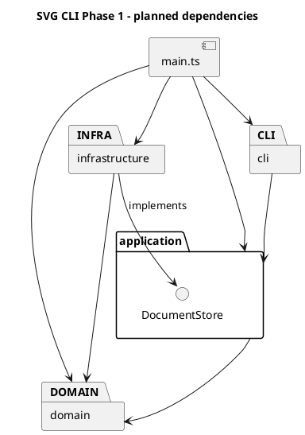

# Lab1 Phase 1：SVG 编辑器（CLI）

## 1. 目标、范围与进度

使用 TypeScript 面向对象设计实现命令行 SVG 编辑器，重点是 Command、Composite、模块依赖和真实的 AI 协作过程。

**M1 已本地提交（82eca1b）；M2-A 和 M2-B 已实现、通过架构审核及最终验收，纳入本次 M2 本地提交。** 入口仍只输出环境提示。已实现六种图形、文档树、图形工厂与深拷贝；REPL、编辑命令、撤销重做及 SVG 解析尚未实现，M3 尚未开始。下文的应用层对象仍属于设计方案。

需求依据：课程 `phase_cli_1.md`，本机原件位于 `D:/learning/读研/1.1/高级软件开发/phase_cli_1.md`。本说明不替代原始要求。

| 类别 | Phase 1 范围 |
| --- | --- |
| 交互 | svg> 提示符、逐行输入、# 开头的注释行、双引号参数、成功摘要、error: 错误前缀 |
| 文档 | init、read、save、canvas；默认画布 800×600 |
| 图形 | rect、circle、ellipse、line、text、g |
| 编辑 | create（含 in）、delete、move、scale、set、group、ungroup、addto、front、back |
| 查询 | tree（含关键几何属性）、show（含父级）、help |
| 历史 | undo/redo，一条编辑一个单元，新编辑清空 redo，文档操作后的禁用规则 |
| 文件 | 保存标准 SVG；读入约定子集；缺 id 自动补齐并警告 |

图形和容器 id 在全文档内唯一且大小写敏感。失败不改变文档、路径和历史。未指定 fill/stroke 时保持缺省；scale 同时缩放位置与尺寸；根级容器禁止 ungroup。set 只允许原文规定的属性。

不实现 box、ShapeProvider 插件、动态加载、GUI 或路径寻址；create box 按未知类型报错。

交付需 Git 分步提交并推送远程仓库，最终提交在截止时间前打 final 标签。本文件须包括架构、过程、一致性自查及质量保证。M1 不执行提交、推送或标签操作；远程仓库与截止时间待用户提供。

## 2. 环境、脚本与目录

已检查的环境：Node.js 20.9.0、npm 10.1.0、Git 2.38.1；依赖 TypeScript 5.9.3、tsx 4.23.15、@types/node 20.19.43，版本由 package-lock.json 锁定。M1 未增加依赖。

在 VS Code 打开项目根目录；Windows PowerShell 可以使用 npm.cmd 替代 npm，避免 npm.ps1 执行策略问题。

| 命令 | 用途 |
| --- | --- |
| npm run cli | 使用 tsx 运行当前环境检查入口 |
| npm run typecheck | 检查生产代码和测试代码，不生成文件 |
| npm run build | 将 src 编译到 dist，不编译测试到发布目录 |
| npm test | 使用 Node 内置 node:test 和已有 tsx 运行 TypeScript 测试 |
| npm start | 运行 dist/main.js，需要先 build |

F5 沿用已有配置，先编译再调试。打开 examples/preview.svg 可用 SVG Preview 或浏览器查看。

```text
assignment1/
├── .vscode/                 # 已有任务、调试和编辑器配置
├── src/
│   ├── main.ts              # 临时环境入口；未来只组装对象
│   ├── EnvironmentCheck.ts  # 临时检查类，不是业务模型
│   ├── cli/.gitkeep
│   ├── application/.gitkeep
│   ├── domain/
│   │   ├── Shape.ts
│   │   ├── ShapeFactory.ts
│   │   ├── SvgDocument.ts
│   │   └── shapes/          # Rect.ts、Circle.ts、Ellipse.ts、Line.ts、Text.ts、Group.ts
│   └── infrastructure/.gitkeep
├── tests/
│   ├── EnvironmentCheck.test.ts
│   └── domain/             # Shapes.test.ts、Tree.test.ts
├── examples/preview.svg
├── doc/README.md
├── package.json
├── package-lock.json
├── tsconfig.json
├── tsconfig.test.json
├── .npmrc
└── .gitignore
```

.gitkeep 使 Git 保留空目录，不创建空业务类；添加实际文件后可移除。node_modules、dist、.npm-cache 和日志已忽略。项目内 npm 缓存沿用此前解决写权限问题的配置。

保留原 tsconfig.json 的严格检查、NodeNext、sourceMap 和 dist/main.js 输出布局。tsconfig.test.json 继承它，将 rootDir 放宽到项目根并启用 noEmit，覆盖 src 和 tests。测试脚本显式指定入口测试、叶子测试及树模型测试三个文件，避免 Windows shell 通配符差异；新增测试文件时同步调整入口。

## 3. 模块划分与依赖规则

| 模块 | 职责及计划对象 | 边界 |
| --- | --- | --- |
| domain | Shape、六种图形类、SvgDocument、ShapeFactory；几何行为、属性合法性、唯一 id 与树结构约束 | 不依赖其他三层，不读取终端或文件，不打印 |
| application | 独立命令类、CommandHistory、EditorSession、CommandDispatcher；组织用例和历史规则 | 依赖 domain，通过自身定义的 DocumentStore 接口请求存储 |
| cli | CliApplication、CommandParser、ConsoleRenderer；读入、分词、显示 | 调用 application，不直接修改图形或访问文件 |
| infrastructure | SvgFileStore、SvgCodec；文件操作、XML 转换 | 依赖应用层存储接口及 domain，不管理历史 |
| main.ts | 创建并连接各层对象 | 允许依赖各层，不承载业务规则 |

以下 PlantUML 包图表示计划中的代码依赖，不是运行时调用顺序。



依赖规则与理由：

1. domain 不知道终端和磁盘，可直接测试图形规则。
2. application 不导入 infrastructure，依赖自身 DocumentStore 接口；测试可用内存替代实现模拟读写失败。
3. cli 不直接导入 domain/infrastructure，避免绕过命令和历史；显示所需的只读结果由 application 提供。
4. infrastructure 构建和转换领域对象，但不执行编辑命令或更改历史。
5. main 只组装对象；层内也避免循环依赖。后续违反规则的依赖应记录为待处理项。

按名字分派只集中于 CommandDispatcher（命令名）和 ShapeFactory（图形类型），按作业要求两处均标为**待重构点**，M1 不实现。SVG 导入复用图形工厂，不另建一套标签分派。几何依靠多态；显示和序列化通过对象提供的只读描述取得数据，不到处 switch(tag)。只读传输描述不持有可修改的业务状态，不能替代有行为的领域对象。

## 4. Command 与快照恢复方案

每种编辑由独立 Command 对象表达。例如 MoveCommand 保存目标 id、dx、dy，执行时取得当前文档并调用 document.move(id, dx, dy)，文档再多态调用目标图形的 move。M2-B 明确 find 返回独立副本，命令不能通过 find(id).move(...) 修改文档。命令负责用例，图形负责几何规则，文档维护受控编辑边界，历史管理器负责记录恢复。快照只是撤销的实现手段，不能把编辑退化成过程式大函数。

暂定一次成功编辑保存文档的前后深拷贝快照。查询不进入历史；失败编辑不产生历史、不清空 redo，也不解除 IO 禁用状态。

为避免快照恢复后对象引用失效，约定：

- EditorSession 是稳定对象，持有可替换的当前文档。
- 命令长期只保存 id、不可变参数和稳定的 session；不缓存 Shape、Group、旧文档或子节点数组。查询从当前文档取得副本，编辑通过当前文档的按 id 方法执行。
- CLI 不缓存可修改的领域对象，对外提供只读结果。
- 深拷贝保留实际类和方法，不能把 JSON.parse/stringify 得到的数据袋当作领域模型。
- 记录和恢复都要复制，避免新编辑修改历史快照；父子关系、顺序、属性缺省状态都要保留。
- 若后续增加 id 索引，恢复时重建索引，不能保留旧对象引用。当前先递归查找，不引入索引维护复杂度。
- 编辑前先校验；复杂编辑中途失败则恢复编辑前快照。只在编辑成功后修改历史。

后续将用“撤销后编辑同一 id”“删除容器再撤销”“分组恢复父级与顺序”等用例验证引用问题，M1 尚未实现这些行为。

完整快照比逆操作占用更多内存，但小型课程项目中更容易正确恢复；暂不引入增量日志或复杂历史框架。

## 5. Composite 方案

Shape 提供 move、scale、set 等共同接口；Rect、Circle 等是叶子，Group 私有持有 Shape 子节点。Group 移动/缩放时调用孩子的对应方法，孩子可以继续是 Group，命令无需判断目标是叶子还是容器。

图形封装可修改字段，通过方法校验几何和属性。SvgDocument 维护唯一 id 和结构变更入口；Group 的 withChildren 产生新的容器，children 返回冻结列表中的独立图形副本，外部不能直接更改内部树。delete 通过文档统一入口移除节点及整棵子树。

统一操作不意味着所有类型接受所有属性：Group 没有 width，应该拒绝此类 set。普通 g 的样式暂拟使用 SVG 继承，不采用 box 的特殊传播规则。

## 6. 已确认决策、假设与歧义

### 已确认

- 四层架构，TypeScript 面向对象，一类一文件且文件名与类名一致。
- 独立 Command、Composite、暂定深拷贝快照，不提前生成空业务类。
- 成功 init/read/save/canvas 尺寸修改后禁止 undo/redo。清空旧历史作为内部策略，下次成功编辑开始新历史；失败不改变状态。
- canvas 无参数查询不影响历史。
- 几何行为和属性合法性在图形类内部，不开放任意修改字段。
- 不引入通用插件框架；不实现 box。
- # 只在注释行起始起作用，命令中的 #ffffff 必须保留为颜色参数。

### 待确认假设

| 问题 | 暂定方案或待明确内容 |
| --- | --- |
| 跨父容器 group | 同父级放在最早被选节点位置；跨父级新组放根级末尾，孩子按操作前文档遍历顺序排列。原文未规定完整规则，需在 M5 前确认 |
| 普通 g 的 set | 样式写到 g，让未显式设置属性的孩子继承，不覆盖孩子显式样式 |
| front/back | front 是视觉最上层，即同级 SVG 列表末尾；back 是开头 |
| save 路径 | init 后没有默认路径时要求文件名；显式 save 成功后建议更新默认路径，原文仅明确 read 路径 |
| help | 建议无文档也可使用，与启动提示一致；原文“其他命令”表述较宽 |
| 数值/语法 | 建议拒绝 NaN/Infinity、允许负坐标；零尺寸、init 单参数、引号转义、空历史错误、无效果编辑是否入栈需提前定表 |
| 自动 id | 先收集全部显式 id，再分配未占用的标签名+序号；显式重复 id 拒绝读入 |

### SVG 导入范围

最低目标是六种元素、嵌套 g、课程列出的几何/样式属性、文本及补 id，使自身输出和原文 other.svg 可读回。

完整任意 SVG 兼容性不是当前承诺。背景例子含 transform、font-size、text-anchor，但命令白名单和导入细则未完整定义处理方式。transform、非默认 viewBox、单位、style/CSS、path/defs/use 及未知属性的支持范围需在 M7 前确认。不能静默丢弃影响画面的信息；决定不支持时应明确报错并保持原文档。data-kind="box" 若纳入导入测试，遵循原文降级为普通 g 的语义，不创建 box 类型。

本轮不实现解析、不选择或安装 XML 库。计划先构建并验证临时文档，再替换当前文档；解析失败不污染原状态。文本/属性转义、子节点顺序及属性缺省是后续往返测试重点。

## 7. 变化点与取舍

| 变化点 | 本阶段准备 | 暂不做的事及理由 |
| --- | --- | --- |
| 新命令 | 独立命令类、集中分发 | 不做通用命令插件 |
| 新图形 | Shape 多态、集中工厂 | 不做 ShapeProvider/box，避免提前设计不确定接口 |
| 新交互方式 | CLI 与应用分离 | 不实现 GUI/网络服务 |
| 存储变化 | 小型 DocumentStore 接口隔离 IO | 不构建通用存储平台 |
| 大文档 | 集中管理历史，便于以后替换快照策略 | 暂不做增量快照和复杂索引，先保证正确性 |
| 导入范围变化 | XML 封装在 infrastructure | 不承诺完整 SVG 规范兼容 |

## 8. 八个里程碑

| 阶段 | 范围 | 验证与提交节点 |
| --- | --- | --- |
| M1 工程基线 | 目录、脚本、最小测试、架构文档 | 四条命令验证，用户审核后首次提交 |
| M2 领域模型 | 六种图形、几何/属性、文档树、唯一 id | 对象级测试含非法输入与嵌套行为，通过后提交 |
| M3 最小交互 | REPL、分词、init/create/tree/show/help、Command 入口及创建历史 | 引号、注释、创建及撤销重做闭环，通过后提交 |
| M4 编辑与历史 | move/scale/set/delete/canvas、完整历史规则 | 执行/撤销/重做、失败原子性、快照独立性及引用恢复，通过后提交 |
| M5 层级与顺序 | group/ungroup/addto/front/back/in | 循环防护、根级限制、父级和顺序恢复，通过后提交 |
| M6 保存 | XML 序列化、路径、文件写入、IO 历史限制 | 转义、浏览器预览、写入失败，通过后提交 |
| M7 读入 | 约定子集、补 id、验证后替换 | other.svg、读写往返、坏文件/重复 id 不污染状态，通过后提交 |
| M8 综合交付 | 示例回放、边界测试、依赖自查、文档 | 全命令覆盖及干净安装构建，最终修正提交后安排推送和 final 标签 |

每阶段先解释设计，再实现、验证和记录，审核后推进；可有多个小提交，不能将全部实现压成一次提交。

## 9. AI 协作过程

- 2026-10-26 环境准备：读取原文，复用已有工具，安装项目 TypeScript/tsx/Node 类型及 SVG Preview。npm 原缓存目录不可写，改用项目缓存。
- 架构讨论：AI 提出四层及八阶段方案，划分 Phase 1 与插件阶段，识别 group、SVG 导入及历史规则歧义。用户审核后保留四层和八阶段。
- M1 用户修订：快照不能替代 Command，需避免恢复后的引用问题；跨父级 group 仅为假设；canvas 查询不影响历史；禁止本轮提交和提前实现业务。
- M1 工程调整：保留生产配置与入口，用独立测试配置检查测试文件；采用 Node 内置测试验证真实入口和中文输出；四层只建立目录占位。

后续记录真实反例、修正和验证，不补造未发生的讨论或结果。

## 10. 一致性自查与质量保证

当前四层目录与计划一致。M2-B 的图形、文档与工厂仅依赖领域层，没有反向依赖 CLI、应用或基础设施；其余业务模块尚未实现。EnvironmentCheck 暂留 src 根目录作为工程基线，接入真实 CLI 时需更新入口及相应测试。

最小测试启动真实 src/main.ts，检查退出码、环境提示、中文输出及“实验命令尚未实现”说明。它验证 TypeScript 加载、入口连接和测试框架，不验证图形业务。

### M1 实际验证记录（2026-10-26）

在项目根目录使用 Windows PowerShell 执行以下命令，均成功退出（退出码 0）。npm.cmd 与本节上方 npm 命令对应同一组脚本。

| 实际命令 | 实际结果 |
| --- | --- |
| `npm.cmd run cli` | 输出 Environment OK、Node.js v20.9.0、UTF-8 中文提示及“实验命令尚未实现” |
| `npm.cmd run typecheck` | 生产配置与测试配置均通过，无类型错误 |
| `npm.cmd run build` | tsc 成功编译 |
| `npm.cmd test` | TAP 报告 tests 1、pass 1、fail 0、skipped 0 |

本次未遇到编译或测试错误。Git 状态为 master 尚无提交，项目文件均未跟踪；新增四层占位文件与测试配置均出现在状态清单中。未执行暂存、commit、push 或 tag，未新增依赖。

后续需对象测试、命令历史测试、文件往返、CLI 脚本回放及浏览器预览；抽样审查 import 并记录依赖违规项。PlantUML 当前提供文本源码，尚未进行渲染验证。M1 测试通过只说明工程基线可用，不表示业务功能完成。

## 11. M2-A：叶子图形实现（2026-10-27）

### 已实现与设计取舍

新增 domain/Shape.ts 及 domain/shapes 下 Rect、Circle、Ellipse、Line、Text 五个类，一类一文件。Shape 定义抽象 move、scale、describe，提供公共 set 样式校验，通过受保护的 setGeometry 多态处理各类专属属性。属性白名单检查不是按图形标签分派；当前没有 switch(tag)、图形工厂或业务自由函数。

- 状态使用 JavaScript # 私有字段，id 只有 getter。id 非空且不含空白，保留大小写和中文；文档内唯一性留给 M2-B，不使用全局注册表。
- describe 返回冻结的独立描述及冻结的 attributes。值均为基本类型，不泄漏内部引用；这是只读展示数据，不是可写业务模型，也不是未来恢复快照。
- text 内容在描述的 text 字段，和 SVG attributes 分离。空文本合法；移动缩放不改变内容。
- 领域层几何输入必须是 number，set 的数字属性也不接受 "12" 字符串；后续输入层负责转换，避免空字符串意外转为零。所有数值及运算结果必须有限。
- 本轮采用可审核的边界策略：负坐标合法；宽高、半径和 stroke-width 可为零但不能为负；scale 系数为有限正数。这细化了此前未定的零尺寸策略，不声称课程原文规定了所有边界。
- scale 乘到全部几何位置和尺寸，stroke-width 属样式暂不随之缩放。Text 只有 x/y 几何字段，不额外加入 font-size。
- fill/stroke 不补默认值；只检查非空字符串，不实现 CSS 颜色语法解析器。传入样式被复制，不保留调用者的可修改引用。
- move/scale 先生成并检查全部候选几何值，再一次替换私有状态；set 先校验再赋值。包括数值溢出在内的失败不会留下部分变更，无需提前引入 Undo/Redo。
- 领域层抛出 Error，不打印、不添加 CLI 的 error: 前缀，未来由 CLI 统一处理展示。

公共校验在基类复用，具体几何公式和白名单保留在各子类内。少量重复让初学者可以直接读懂每种图形的行为，本轮不为减少行数引入通用几何引擎或额外继承层。

### 测试与验证

新增 tests/domain/Shapes.test.ts：五种图形分别覆盖创建、缺省样式、移动、缩放、每个几何属性和公共样式修改、非法输入、构造校验、零尺寸、运算溢出、只读描述及 id。额外验证文本内容和跨类型属性拒绝。共享测试用例以 Shape 类型调用对象，验证相同接口下的不同几何行为。

实际执行结果：npm.cmd run typecheck、npm.cmd run build、npm.cmd test、npm.cmd run cli 均以退出码 0 完成；测试共 38 项通过、0 项失败、0 项跳过（37 项领域测试加 1 项原有入口测试）。入口保持原来的环境提示。未新增依赖，未更改入口或编译配置。

### 过程与一致性记录

用户限定本轮为 M2-A，不实现 Group、SvgDocument、ShapeFactory 或应用层。AI 在实现前说明了数值边界和原子修改策略；测试增加“前一个坐标可成功、后一个坐标溢出”的反例，验证不会先改一半再报错。当前领域类仅相互依赖，不导入其他三层。

移除已不需要的 domain/.gitkeep，另外三层占位仍保留。M1 已于此前完成首次提交 82eca1b；本轮仅修改工作区，等待用户审核，不提交、不推送、不打标签。M2-B 及后续里程碑仍未开始。

## 12. M2-B：容器、文档、工厂与深拷贝（2026-10-27）

### M2-A 自查与最小扩展

重新审阅 Shape 和五个叶子类：move/scale/set 均在校验成功后才赋值，失败不改状态；describe 返回冻结独立描述，不泄漏内部对象；各类单独文件且只依赖领域层，没有图形类型分派。没有发现需要修复的叶子行为错误。

现有接口不足以表达深拷贝和树描述，因此为 Shape 增加抽象 clone、容器能力标识 isContainer、children 查询及产生新结构的 withChildren；ShapeDescription 增加可选 children。叶子 children 为空，withChildren 明确拒绝。五个叶子的 clone 通过各自构造器保留类行为、id、几何、文本与样式，不改变原有几何公式。

### 已实现对象与接口

| 对象 | 主要接口与职责 |
| --- | --- |
| Group | 嵌套容器，继承 Shape；move/scale 多态递归；set 只设置组本身公共样式；withChildren 返回新组；私有保存子节点副本 |
| SvgDocument | 默认 800×600；resize、add、delete、find、getParentId、reparent、move、scale、set、describe、clone；管理尺寸、全文档唯一 id 和顺序 |
| ShapeFactory | create(type, id, params)，六种类型集中分派；检查参数数量，数值、id、文本和样式合法性仍交给图形类 |

工厂接受已经转换为 number 的几何参数，text 内容仍为 string；可选 fill/stroke 按原文位置传入。工厂中的类型断言不做运行时转换，实际值仍由图形构造器验证。未知类型（包括 box）抛出原文规定的 unknown shape type 错误。这里只创建对象，不查文档重复 id，也不解析 CLI 文本或 in 子句。

### 所有权与结构原子性

本阶段细化了 M1 的封装策略：**文档独占内部树，输入复制、查询返回副本，写操作按 id 进行。**

- Group 构造器复制输入子节点；同一外部对象放入不同容器会成为独立副本，不会形成共享父子引用。同一树内相同 id（包括根与后代）仍会被拒绝。
- Group.children 和 SvgDocument.children 返回冻结数组，其中对象是独立克隆。调用者可编辑副本，但不会改变源树。describe 返回递归冻结的只读数据。
- Group.withChildren 是结构替换构造方法，不修改原组。没有公共原地 addChild/removeChild，也没有可随意赋值的父指针，外部不能绕过文档去挂接节点。
- SvgDocument.find 返回独立 Shape 副本，找不到返回 undefined；编辑使用 document.move/scale/set，不使用 find 的结果写回。getParentId 对顶层返回 null，对缺失 id 抛错，便于后续命令检查顶层 ungroup 限制。
- add/delete/reparent 先生成候选结构，检查全部 id，再复制候选树并一次替换根集合。删除返回独立子树，后续可重新添加。
- reparent 先检查目标存在且为容器，拒绝自身与后代作为目标。新位置 index 是“源节点移除后”的目标列表索引，允许 0 到列表长度；省略为末尾。该方法也能调整同级顺序，但不是 front/back/group/ungroup CLI 命令。
- Group move/scale 先克隆孩子，逐一执行；若深层节点溢出则丢弃候选，原组和之前兄弟都不变。文档的几何编辑也先在目标副本上完成，最后统一替换。
- 组样式写在 g 自己上，保留孩子的缺省属性与显式颜色。实际 SVG 继承显示留给以后序列化和浏览器，不提前展开样式。

文档画布尺寸暂采用有限正数（可为浮点数），与叶子宽高可为零区分。resize 先同时验证两个尺寸再赋值。此为本阶段记录的边界策略。

### 深拷贝与后续快照

clone 返回同一实际类的新实例。Group 递归复制子树，SvgDocument 复制尺寸、根顺序及全部后代，不共享可变状态；id、文本和缺省样式完整保留，不通过 JSON 恢复类型。

不保证编辑前后内部对象身份稳定；该身份本来就不暴露给外部。未来 Command 保留 id 和稳定 session，从 session 取当前文档调用受控方法。当前没有 Command、CommandHistory 或 Undo/Redo；clone 只是后续快照所需的领域能力。

### 取舍、风险及架构修订

四层依赖方向、Command 与 Composite 的分工不变，无须重划 M1 模块。需要细化的是 M1 中“命令查找图形后操作”的表述，已改为“命令通过当前文档按 id 操作”，明确 find 是查询副本。

所有结构更改都能在失败前保留原树，代价是重复复制与递归遍历。当前优先保证小型课程文档的正确性，不保证大文档性能或极深嵌套的调用栈安全。今后若实际规模需要，可优化内部遍历与复制，但仍必须保留所有权和原子性契约。clone 的正确性以本阶段六种内置类型为范围，不提供任意第三方子类或插件保证。

ShapeFactory 是当前唯一按图形类型名分派的位置，已按课程要求标记待重构；其他层只使用多态或 isContainer 能力判断，没有分散的 switch(tag)。新增各类各自独立文件；接口类型与相关类共文件，不增加空类或通用框架。

### 协作与实际验证

实现前指出两个风险：简单循环调用孩子会在后面的孩子失败时留下部分更新；若外部可以直接修改文档内的 Group，则可能绕过全文档 id 检查。选用副本所有权与候选树提交解决，并将这个与 M1 相比更具体的接口约束记入本节。

新增 tests/domain/Tree.test.ts，共 24 项测试，包含嵌套几何、末尾后代失败原子性、普通组样式、自包含/循环拒绝、重复 id（含子树冲突）、非法目标/索引、顺序、父级查询、删除、输入输出引用隔离、六类双向克隆独立性、文档克隆及工厂参数校验。

实际执行：npm.cmd run typecheck、npm.cmd run build、npm.cmd test 均退出 0；总计 62 项测试通过、0 失败、0 跳过，其中原有 38 项继续通过。git diff --check 通过（仅有 Git 的 LF/CRLF 换行提示，不是差异检查错误）。没有编译或测试失败；未新增依赖，未改 M1 程序入口。

截至 M2-B 开发轮结束，M2-A 文件仍未提交，git status 同时包含两部分工作区内容；当轮未暂存、commit、push 或打标签。随后用户批准最终验收与本地提交，见下一节。未提前实现 CLI、命令历史、SVG 文件读写或插件。

## 13. M2 最终验收（2026-10-27）

用户审核 M2-A/M2-B 后授权一次本地提交。重新检查全部领域类和测试，未发现需最小修复的实际错误、意外修改或需要重构的问题，因此保留已审核的业务实现，没有增加未来阶段的接口。

- Group 的嵌套 move/scale 在候选子树上执行，失败不会替换原孩子集合。
- add/delete/reparent 通过候选树校验和复制维护全文档 id 唯一性与顺序。
- find 对顶层和深层结果都再次 clone，外部编辑查询结果不会修改文档。
- 六种 clone 均保留实际类、id、属性、样式缺省、文本及嵌套顺序。
- add 的插入位置、reparent 的目标位置、getParentId 及有序 children 查询，足以为后续 group/ungroup/front/back 提供基础；clone 可保存原父子关系和顺序。多次结构调用本身不构成一个事务，未来复合命令应在文档副本上完成全部步骤后发布，或按已定快照策略恢复失败状态；本轮没有实现这些命令或历史管理。
- 一类一文件；类型名分派仅位于 ShapeFactory；领域 import 没有指向其他三层。此前记录的复制开销、递归深度及仅支持内置类型的风险仍适用。

本轮重新执行的实际结果：

| 命令 | 结果 |
| --- | --- |
| npm.cmd run typecheck | 退出码 0，源码及测试类型检查通过 |
| npm.cmd run build | 退出码 0，编译成功 |
| npm.cmd test | 退出码 0，62 项通过、0 失败、0 跳过 |
| git diff --check | 退出码 0，无空白错误 |

提交范围为领域源码、两份领域测试、测试脚本调整、领域占位文件移除及本文档。检查未发现密码、Token、私钥或证书；node_modules、dist、.npm-cache 和日志仍由 .gitignore 排除。提交信息为 feat: implement SVG domain model and composite shapes，仅本地提交，不推送、不创建 final 标签、不开始 M3。实际提交哈希以 Git 日志为准，避免在提交文件中预写尚未生成的哈希。
