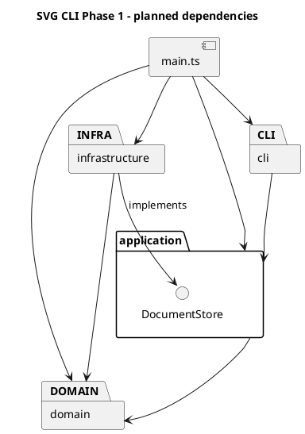

# Lab1 Phase 1：SVG 编辑器（CLI）

## 1. 目标、范围与进度

使用 TypeScript 面向对象设计实现命令行 SVG 编辑器，重点是 Command、Composite、模块依赖和真实的 AI 协作过程。

**当前仅完成 M1 工程基线工作，等待用户审核。** 入口只输出环境提示；图形类、REPL、编辑命令、撤销重做及 SVG 解析尚未实现。下文的业务类名称与行为均为设计方案。

需求依据：课程 `phase_cli_1.md`，本机原件位于 `D:/learning/读研/1.1/高级软件开发/phase_cli_1.md`。本说明不替代原始要求。

| 类别 | Phase 1 范围 |
| --- | --- |
| 交互 | svg> 提示符、逐行输入、# 开头的注释行、双引号参数、成功摘要、error: 错误前缀 |
| 文档 | init、read、save、canvas；默认画布 800×600 |
| 图形 | rect、circle、ellipse、line、text、g |
| 编辑 | create（含 in）、delete、move、scale、set、group、ungroup、addto、front、back |
| 查询 | tree（含关键几何属性）、show（含父级）、help |
| 历史 | undo/redo，一条编辑一个单元，新编辑清空 redo，文档操作后的禁用规则 |
| 文件 | 保存标准 SVG；读入约定子集；缺 id 自动补齐并警告 |

图形和容器 id 在全文档内唯一且大小写敏感。失败不改变文档、路径和历史。未指定 fill/stroke 时保持缺省；scale 同时缩放位置与尺寸；根级容器禁止 ungroup。set 只允许原文规定的属性。

不实现 box、ShapeProvider 插件、动态加载、GUI 或路径寻址；create box 按未知类型报错。

交付需 Git 分步提交并推送远程仓库，最终提交在截止时间前打 final 标签。本文件须包括架构、过程、一致性自查及质量保证。M1 不执行提交、推送或标签操作；远程仓库与截止时间待用户提供。

## 2. 环境、脚本与目录

已检查的环境：Node.js 20.9.0、npm 10.1.0、Git 2.38.1；依赖 TypeScript 5.9.3、tsx 4.23.15、@types/node 20.19.43，版本由 package-lock.json 锁定。M1 未增加依赖。

在 VS Code 打开项目根目录；Windows PowerShell 可以使用 npm.cmd 替代 npm，避免 npm.ps1 执行策略问题。

| 命令 | 用途 |
| --- | --- |
| npm run cli | 使用 tsx 运行当前环境检查入口 |
| npm run typecheck | 检查生产代码和测试代码，不生成文件 |
| npm run build | 将 src 编译到 dist，不编译测试到发布目录 |
| npm test | 使用 Node 内置 node:test 和已有 tsx 运行 TypeScript 测试 |
| npm start | 运行 dist/main.js，需要先 build |

F5 沿用已有配置，先编译再调试。打开 examples/preview.svg 可用 SVG Preview 或浏览器查看。

```text
assignment1/
├── .vscode/                 # 已有任务、调试和编辑器配置
├── src/
│   ├── main.ts              # 临时环境入口；未来只组装对象
│   ├── EnvironmentCheck.ts  # 临时检查类，不是业务模型
│   ├── cli/.gitkeep
│   ├── application/.gitkeep
│   ├── domain/.gitkeep
│   └── infrastructure/.gitkeep
├── tests/EnvironmentCheck.test.ts
├── examples/preview.svg
├── doc/README.md
├── package.json
├── package-lock.json
├── tsconfig.json
├── tsconfig.test.json
├── .npmrc
└── .gitignore
```

.gitkeep 使 Git 保留空目录，不创建空业务类；添加实际文件后可移除。node_modules、dist、.npm-cache 和日志已忽略。项目内 npm 缓存沿用此前解决写权限问题的配置。

保留原 tsconfig.json 的严格检查、NodeNext、sourceMap 和 dist/main.js 输出布局。tsconfig.test.json 继承它，将 rootDir 放宽到项目根并启用 noEmit，覆盖 src 和 tests。测试脚本当前显式指定唯一测试文件，避免 Windows shell 通配符差异；新增测试时同步调整入口。

## 3. 模块划分与依赖规则

| 模块 | 职责及计划对象 | 边界 |
| --- | --- | --- |
| domain | Shape、六种图形类、SvgDocument、ShapeFactory；几何行为、属性合法性、唯一 id 与树结构约束 | 不依赖其他三层，不读取终端或文件，不打印 |
| application | 独立命令类、CommandHistory、EditorSession、CommandDispatcher；组织用例和历史规则 | 依赖 domain，通过自身定义的 DocumentStore 接口请求存储 |
| cli | CliApplication、CommandParser、ConsoleRenderer；读入、分词、显示 | 调用 application，不直接修改图形或访问文件 |
| infrastructure | SvgFileStore、SvgCodec；文件操作、XML 转换 | 依赖应用层存储接口及 domain，不管理历史 |
| main.ts | 创建并连接各层对象 | 允许依赖各层，不承载业务规则 |

以下 PlantUML 包图表示计划中的代码依赖，不是运行时调用顺序。



依赖规则与理由：

1. domain 不知道终端和磁盘，可直接测试图形规则。
2. application 不导入 infrastructure，依赖自身 DocumentStore 接口；测试可用内存替代实现模拟读写失败。
3. cli 不直接导入 domain/infrastructure，避免绕过命令和历史；显示所需的只读结果由 application 提供。
4. infrastructure 构建和转换领域对象，但不执行编辑命令或更改历史。
5. main 只组装对象；层内也避免循环依赖。后续违反规则的依赖应记录为待处理项。

按名字分派只集中于 CommandDispatcher（命令名）和 ShapeFactory（图形类型），按作业要求两处均标为**待重构点**，M1 不实现。SVG 导入复用图形工厂，不另建一套标签分派。几何依靠多态；显示和序列化通过对象提供的只读描述取得数据，不到处 switch(tag)。只读传输描述不持有可修改的业务状态，不能替代有行为的领域对象。

## 4. Command 与快照恢复方案

每种编辑由独立 Command 对象表达。例如 MoveCommand 保存目标 id、dx、dy，执行时找到当前目标并调用其 move 方法。命令负责用例，图形负责几何规则，历史管理器负责记录恢复。快照只是撤销的实现手段，不能把编辑退化成过程式大函数。

暂定一次成功编辑保存文档的前后深拷贝快照。查询不进入历史；失败编辑不产生历史、不清空 redo，也不解除 IO 禁用状态。

为避免快照恢复后对象引用失效，约定：

- EditorSession 是稳定对象，持有可替换的当前文档。
- 命令长期只保存 id、不可变参数和稳定的 session；不缓存 Shape、Group、旧文档或子节点数组。需要对象时从当前文档重新查找。
- CLI 不缓存可修改的领域对象，对外提供只读结果。
- 深拷贝保留实际类和方法，不能把 JSON.parse/stringify 得到的数据袋当作领域模型。
- 记录和恢复都要复制，避免新编辑修改历史快照；父子关系、顺序、属性缺省状态都要保留。
- 若后续增加 id 索引，恢复时重建索引，不能保留旧对象引用。当前先递归查找，不引入索引维护复杂度。
- 编辑前先校验；复杂编辑中途失败则恢复编辑前快照。只在编辑成功后修改历史。

后续将用“撤销后编辑同一 id”“删除容器再撤销”“分组恢复父级与顺序”等用例验证引用问题，M1 尚未实现这些行为。

完整快照比逆操作占用更多内存，但小型课程项目中更容易正确恢复；暂不引入增量日志或复杂历史框架。

## 5. Composite 方案

Shape 提供 move、scale、set 等共同接口；Rect、Circle 等是叶子，Group 私有持有 Shape 子节点。Group 移动/缩放时调用孩子的对应方法，孩子可以继续是 Group，命令无需判断目标是叶子还是容器。

图形封装可修改字段，通过方法校验几何和属性。SvgDocument 维护唯一 id 和结构变更入口，Group 提供受控子节点操作，外部不得直接更改数组。delete 通过文档统一入口移除节点及整棵子树。

统一操作不意味着所有类型接受所有属性：Group 没有 width，应该拒绝此类 set。普通 g 的样式暂拟使用 SVG 继承，不采用 box 的特殊传播规则。

## 6. 已确认决策、假设与歧义

### 已确认

- 四层架构，TypeScript 面向对象，一类一文件且文件名与类名一致。
- 独立 Command、Composite、暂定深拷贝快照，不提前生成空业务类。
- 成功 init/read/save/canvas 尺寸修改后禁止 undo/redo。清空旧历史作为内部策略，下次成功编辑开始新历史；失败不改变状态。
- canvas 无参数查询不影响历史。
- 几何行为和属性合法性在图形类内部，不开放任意修改字段。
- 不引入通用插件框架；不实现 box。
- # 只在注释行起始起作用，命令中的 #ffffff 必须保留为颜色参数。

### 待确认假设

| 问题 | 暂定方案或待明确内容 |
| --- | --- |
| 跨父容器 group | 同父级放在最早被选节点位置；跨父级新组放根级末尾，孩子按操作前文档遍历顺序排列。原文未规定完整规则，需在 M5 前确认 |
| 普通 g 的 set | 样式写到 g，让未显式设置属性的孩子继承，不覆盖孩子显式样式 |
| front/back | front 是视觉最上层，即同级 SVG 列表末尾；back 是开头 |
| save 路径 | init 后没有默认路径时要求文件名；显式 save 成功后建议更新默认路径，原文仅明确 read 路径 |
| help | 建议无文档也可使用，与启动提示一致；原文“其他命令”表述较宽 |
| 数值/语法 | 建议拒绝 NaN/Infinity、允许负坐标；零尺寸、init 单参数、引号转义、空历史错误、无效果编辑是否入栈需提前定表 |
| 自动 id | 先收集全部显式 id，再分配未占用的标签名+序号；显式重复 id 拒绝读入 |

### SVG 导入范围

最低目标是六种元素、嵌套 g、课程列出的几何/样式属性、文本及补 id，使自身输出和原文 other.svg 可读回。

完整任意 SVG 兼容性不是当前承诺。背景例子含 transform、font-size、text-anchor，但命令白名单和导入细则未完整定义处理方式。transform、非默认 viewBox、单位、style/CSS、path/defs/use 及未知属性的支持范围需在 M7 前确认。不能静默丢弃影响画面的信息；决定不支持时应明确报错并保持原文档。data-kind="box" 若纳入导入测试，遵循原文降级为普通 g 的语义，不创建 box 类型。

本轮不实现解析、不选择或安装 XML 库。计划先构建并验证临时文档，再替换当前文档；解析失败不污染原状态。文本/属性转义、子节点顺序及属性缺省是后续往返测试重点。

## 7. 变化点与取舍

| 变化点 | 本阶段准备 | 暂不做的事及理由 |
| --- | --- | --- |
| 新命令 | 独立命令类、集中分发 | 不做通用命令插件 |
| 新图形 | Shape 多态、集中工厂 | 不做 ShapeProvider/box，避免提前设计不确定接口 |
| 新交互方式 | CLI 与应用分离 | 不实现 GUI/网络服务 |
| 存储变化 | 小型 DocumentStore 接口隔离 IO | 不构建通用存储平台 |
| 大文档 | 集中管理历史，便于以后替换快照策略 | 暂不做增量快照和复杂索引，先保证正确性 |
| 导入范围变化 | XML 封装在 infrastructure | 不承诺完整 SVG 规范兼容 |

## 8. 八个里程碑

| 阶段 | 范围 | 验证与提交节点 |
| --- | --- | --- |
| M1 工程基线 | 目录、脚本、最小测试、架构文档 | 四条命令验证，用户审核后首次提交 |
| M2 领域模型 | 六种图形、几何/属性、文档树、唯一 id | 对象级测试含非法输入与嵌套行为，通过后提交 |
| M3 最小交互 | REPL、分词、init/create/tree/show/help、Command 入口及创建历史 | 引号、注释、创建及撤销重做闭环，通过后提交 |
| M4 编辑与历史 | move/scale/set/delete/canvas、完整历史规则 | 执行/撤销/重做、失败原子性、快照独立性及引用恢复，通过后提交 |
| M5 层级与顺序 | group/ungroup/addto/front/back/in | 循环防护、根级限制、父级和顺序恢复，通过后提交 |
| M6 保存 | XML 序列化、路径、文件写入、IO 历史限制 | 转义、浏览器预览、写入失败，通过后提交 |
| M7 读入 | 约定子集、补 id、验证后替换 | other.svg、读写往返、坏文件/重复 id 不污染状态，通过后提交 |
| M8 综合交付 | 示例回放、边界测试、依赖自查、文档 | 全命令覆盖及干净安装构建，最终修正提交后安排推送和 final 标签 |

每阶段先解释设计，再实现、验证和记录，审核后推进；可有多个小提交，不能将全部实现压成一次提交。

## 9. AI 协作过程

- 2026-10-26 环境准备：读取原文，复用已有工具，安装项目 TypeScript/tsx/Node 类型及 SVG Preview。npm 原缓存目录不可写，改用项目缓存。
- 架构讨论：AI 提出四层及八阶段方案，划分 Phase 1 与插件阶段，识别 group、SVG 导入及历史规则歧义。用户审核后保留四层和八阶段。
- M1 用户修订：快照不能替代 Command，需避免恢复后的引用问题；跨父级 group 仅为假设；canvas 查询不影响历史；禁止本轮提交和提前实现业务。
- M1 工程调整：保留生产配置与入口，用独立测试配置检查测试文件；采用 Node 内置测试验证真实入口和中文输出；四层只建立目录占位。

后续记录真实反例、修正和验证，不补造未发生的讨论或结果。

## 10. 一致性自查与质量保证

当前四层目录与计划一致，但业务类尚未实现，不能据此声称业务依赖已验收。EnvironmentCheck 暂留 src 根目录作为工程基线，接入真实 CLI 时需更新入口及相应测试。

最小测试启动真实 src/main.ts，检查退出码、环境提示、中文输出及“实验命令尚未实现”说明。它验证 TypeScript 加载、入口连接和测试框架，不验证图形业务。

### M1 实际验证记录（2026-10-26）

在项目根目录使用 Windows PowerShell 执行以下命令，均成功退出（退出码 0）。npm.cmd 与本节上方 npm 命令对应同一组脚本。

| 实际命令 | 实际结果 |
| --- | --- |
| `npm.cmd run cli` | 输出 Environment OK、Node.js v20.9.0、UTF-8 中文提示及“实验命令尚未实现” |
| `npm.cmd run typecheck` | 生产配置与测试配置均通过，无类型错误 |
| `npm.cmd run build` | tsc 成功编译 |
| `npm.cmd test` | TAP 报告 tests 1、pass 1、fail 0、skipped 0 |

本次未遇到编译或测试错误。Git 状态为 master 尚无提交，项目文件均未跟踪；新增四层占位文件与测试配置均出现在状态清单中。未执行暂存、commit、push 或 tag，未新增依赖。

后续需对象测试、命令历史测试、文件往返、CLI 脚本回放及浏览器预览；抽样审查 import 并记录依赖违规项。PlantUML 当前提供文本源码，尚未进行渲染验证。M1 测试通过只说明工程基线可用，不表示业务功能完成。
